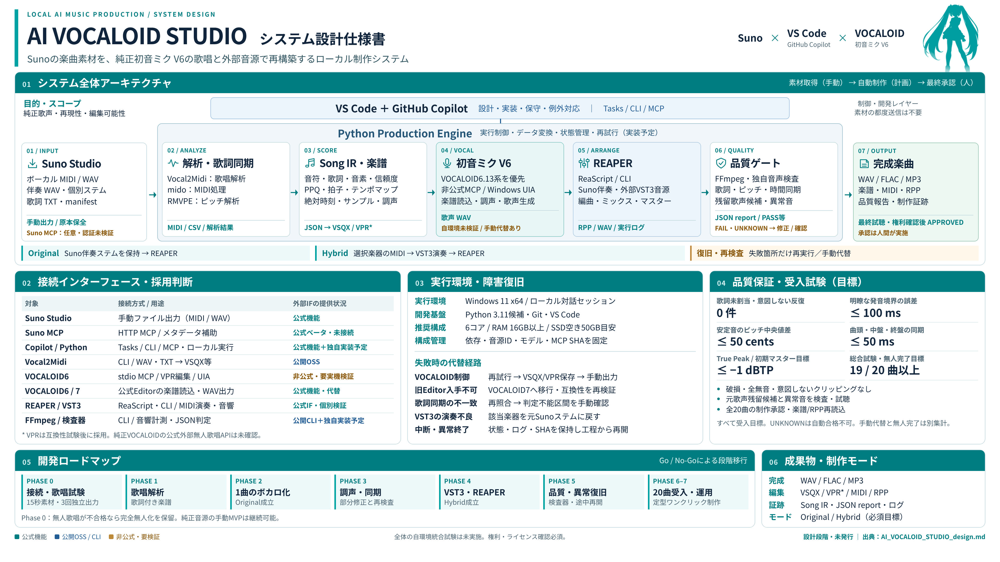

# AI VOCALOID STUDIO

**AIボカロ自動制作基盤 / AI-powered VOCALOID production pipeline**  
Designed by **Gacky (Gacky-Lab)** | Concept announced: 2026-11-24 (JST)

Sunoで生成した楽曲を、純正初音ミク V6（VOCALOID6）で再歌唱し、歌詞同期・調声・楽器置換・編曲・ミックス・品質検査まで一貫処理する制作基盤の設計プロジェクトです。

A proposed automated music production architecture integrating Suno Studio, Hatsune Miku V6, VOCALOID6, VS Code, GitHub Copilot, Python, MCP, REAPER and VST3. The project explores reproducible music production using a common Song IR (JSON), independent production stages, quality gates and recovery paths.

**Status: Design / pre-implementation.** The end-to-end music engine has not yet been implemented or validated in the target Windows environment. One-click production is a goal, not an existing feature.

## Architecture / 技術構成

| Layer | Design |
| --- | --- |
| Input | Suno Studio: manual MIDI, WAV, stems and lyrics export; optional MCP integration |
| Development | VS Code + GitHub Copilot |
| Execution | Python Production Engine; CLI, MCP and UI Automation as appropriate |
| Analysis | Vocal2Midi, RMVPE, mido |
| Data contract | Song IR (JSON): notes, lyrics, phonemes, pitch, tempo and time |
| Singing | VOCALOID6 + Hatsune Miku V6; unofficial MCP / UI Automation to be tested; manual editor fallback |
| Arrangement | REAPER (ReaScript / CLI), VST3 instruments |
| Quality | Lyrics and timing checks, human listening, logging, recovery and reproducibility |

## Data flow / 制作フロー

Suno → MIDI/WAV/lyrics → analysis and alignment → Song IR → VOCALOID score and singing WAV → REAPER/VST3 → quality checks → WAV/FLAC/MP3.

## Executable Phase-0 interfaces（2026-11-24）

実際に実行できる**MIDI→音符候補（Mido）**、歌詞Handoff v1の照合、2種のJSON Schema、オフライン自動テストを追加しました。ここで得られる音符候補は**歌詞・モーラ未整列**であり、完成したSong IRやVOCALOID歌唱音声とは異なります。

- [公開IFの根拠と検証状況](docs/INTERFACES_VERIFIED_2026-11-24.md)
- [15秒の合成MIDIで試す](docs/PHASE0_OFFLINE.md)
- [REAPERの公式ReaScriptに沿ったWAV配置スクリプト生成](docs/REAPER_IMPORT_BRIDGE.md)（GUI実行は未検証）
- [Actionsの実行結果](https://github.com/Gacky-Lab/AI-VOCALOID-STUDIO/actions)

## Documents / 公開資料

- [Integrated design specification (Japanese)](docs/design.md) — 統合設計仕様書、詳細仕様、試験計画、データ契約、可視化契約。
- [Architecture PNG (4K)](images/architecture.png) — HTMLから生成した設計図。
- [Architecture HTML source](docs/architecture.html) — ダウンロードしてブラウザで開くと閲覧できます（GitHubのファイル画面はHTMLソース表示）。
- [Original concept illustration](images/original-concept.png) — Gackyの透かし入り構想図。画像生成AIを用いた初期の説明資料であり、最新の技術仕様はMDを優先します。
- [Visualization validation report](docs/render-report.json) — 可視化資料の参照環境での検査証跡。音楽制作エンジンの実機試験結果ではありません。

## Design principles / 設計思想

製造業の生産技術・DXの考え方を音楽制作に応用する。単にAIで曲を生成するだけでなく、複数の音楽制作技術を接続した再現性のある制作基盤を目指す。

- Preserve original source materials; keep deterministic processing independent of the development assistant.
- Distinguish supported external features, unofficial integrations and locally verified behavior.
- Provide manual fallbacks, logs and checkpoints; require human approval before release.
- Initial test: a 15-second vocal render with the licensed Hatsune Miku voicebank. Automated completion and quality thresholds are acceptance targets, not measured achievements.

## Project history / 公開記録

- 2026-11-24: [Initial concept announcement on X (Gacky)](https://x.com/VG4HsenZZY/status/2125190195372794254).
- This repository collects the design-stage documentation. GitHub publication and subsequent changes are recorded by commit history. The attached specification preserves the original pre-publication wording.

## Author / Links

- Gacky — [X / @VG4HsenZZY](https://x.com/VG4HsenZZY)
- [Gacky-Lab](https://github.com/Gacky-Lab)

## Scope and rights / 権利・注意事項

This is an independent design project, not an official product or partnership with Suno, Yamaha, Crypton Future Media, GitHub, Cockos or other tool providers. Product names and character imagery belong to their respective rights holders. No voicebank, commercial software, third-party music or access credentials are distributed here. Use only legally authorized materials. No blanket reuse license is granted by this initial documentation release; third-party material remains subject to its own terms.
