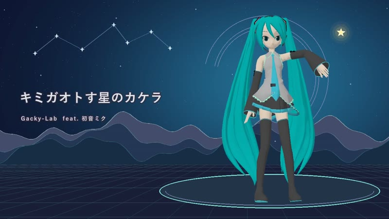

# キミガオトす星のカケラ / Gacky-Lab feat. 初音ミク

[冒頭から最初のサビまで再生する（MP4・60秒）](https://raw.githubusercontent.com/Gacky-Lab/AI-VOCALOID-STUDIO/d6dfab34960c621730030a501c25708a9a8cf48a/docs/case-studies/kakera/dance-mv/Kakera-Miku-First-Chorus-X.mp4)。サビは約28秒から。端末によってはタップすると動画をダウンロードする。

## 制作と検証

Sunoの原唱ステムから音高とモーラを取り、音符・歌詞・ピッチカーブとしてVOCALOID7に入力し、初音ミク V6で再歌唱した。局所修正ごとに前後を含む譜面を実機で再合成し、既存の伴奏と合わせた。制作者が二択試聴で旧版を選んだ区間では、測定値が改善していても旧版に戻した。

|対象|調べたこと|結果|
|---|---|---|
|母音の強弱|全曲580母音を走査し、短すぎる区間や境界の不一致を除いて85母音を比較|最初の包絡補正では11母音を採用。採用部の平均誤差は4.59→3.48 dB。|
|「新しい」の音高|前半・後半の原唱の倍音、音符番号、レンダー後の基本周波数を比較|「ら」に約22半音動くカーブがあり、音高とカーブを修正。両反復を合わせた全候補13音中12音を採用。|
|歌詞の明瞭さ|子音から母音への帯域別レベル変化と、音量をそろえた対比較|1:24は旧版、1:30は新版を選択。1:27の「暗い」は両案とも聞き取りにくいという回答を受け「夜でも」まで再合成。最後の再合成案は試聴承認待ち。|

時刻はフル曲の曲頭が基準。60秒版では1分以降の事例は収録範囲外。[詳細な設計・反復履歴](PRODUCTION-NOTES.md)、[実測JSON](evidence/)、[先行版の7〜12秒の比較と再計算](../README.md)。

## ダンス・映像

歌詞行に「探す」「受け止める」「追う」などの動作を割り当て、腕・視線・向き・星の位置を連動させた。音符から口形を作り、曲の時刻に合わせてレンダーし、動く歌詞を重ねた。フル版の映像と最新WAVの先頭60秒を使用。間奏のクレジットは53.80秒から表示し、最後は映像と音声をフェードアウトする。縦型は同じ60秒に合わせて歌詞・画面構成を作り直した。本ページは横型を掲載。

映像は1280×720、25 fps、1500フレーム。元WAVに対する2・25・55秒での音声ずれはすべて0 ms。音声はAAC、動画はH.264。検算用MP4 SHA-256は `3aa52b4eef4c2db83bfb17a91effdb2d8aca80bde566128925fa5e85adb4429b`。

歌唱は初音ミク V6。振付・ダンスモーション制作はGacky-Lab。3Dモデルはあにまさ式 初音ミク Ver.2。初音ミク © Crypton Future Media, INC. 本作品は「[ピアプロ・キャラクター・ライセンス](https://piapro.jp/license/pcl/summary)」に基づいてクリプトン・フューチャー・メディア株式会社のキャラクター「初音ミク」を描いたものです。第三者のモデル・音源の再利用には各権利者の条件が適用される。
