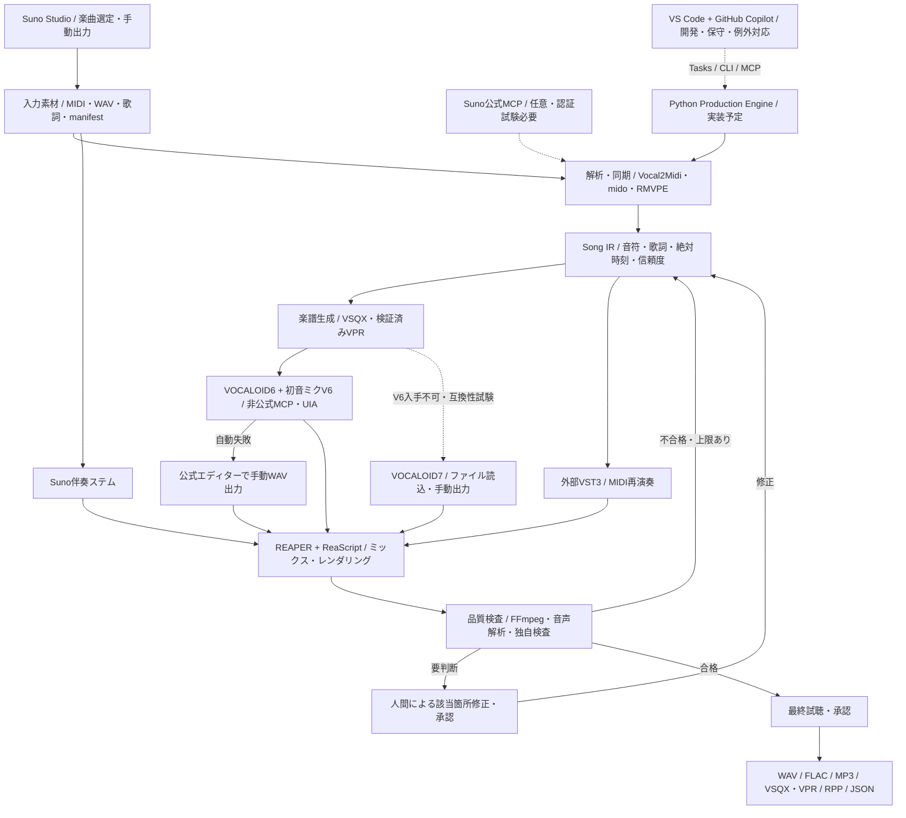

# AI VOCALOID STUDIO — システム設計仕様書

**Suno × VS Code / GitHub Copilot × Python × 初音ミク V6 × REAPER**

| 項目 | 内容 |
|---|---|
| 文書の位置づけ | 開発開始前の基本・実装設計仕様書（未発行・実装前） |
| 調査基準日 | 2026年11月24日 |
| 対象環境 | Windows 11 x64を推奨、ローカルVS Code / GitHub Copilot |
| 制作対象 | 自分が利用権を有するSuno楽曲の純正初音ミクV6による再歌唱・編曲 |
| 現状 | 外部公開仕様の確認・詳細設計段階。ユーザーPCでの接続・歌唱・総合試験は未実施 |

> **開発原則：公式機能・公開実装の存在・自環境での動作成功を区別する。** 本書の数値は設計・受入目標であり実績ではない。非公式VOCALOID制御に依存しない手動代替経路を確保する。完全無人化の成立は実機試験を通過して初めて判断する。

## 詳細仕様・適用順序

本書をマスター仕様とし、詳細契約は次の別紙（単体MDでは巻末付録）を適用する。矛盾がある場合は外部IFの実測・公式仕様を優先し、内部データは同梱JSON Schemaと意味制約を優先する。合格目標を変更する場合は人間の承認と変更記録を要する。

| 別紙 | 内容 |
|---|---|
| INTERFACE_SPEC | MCP、Vocal2Midi、REAPERの接続・結果判定 |
| ALIGNMENT_ALGORITHM | 時間軸・歌詞・音符照合・テストベクトル |
| DATA_AND_EXECUTION_SPEC | データ契約・状態機械・CLI・復旧 |
| QUALITY_AND_ACCEPTANCE | 検査器の評価・要求トレース・受入条件 |
| PHASE0_AND_EVIDENCE | 実機試験の実行手順・証跡・Go/No-Go |

本書は未発行・実装前。100点を実測したという表示は行わない。

## 1. 目的・スコープ

Suno Studioを作曲・編曲・仮歌の素材生成エンジンとして利用し、手動で出力したMIDI、歌声WAV、伴奏ステム、歌詞を起点に、純正初音ミクV6で再歌唱させる。必要に応じて外部VST3音源で編曲し、REAPERによるミックス、マスタリング、品質検査、成果物の保存までを一貫処理する。

- VS Code + GitHub Copilotは設計、実装、テスト、保守、制作指示、例外対応を担う。Claude Codeの追加契約は不要。
- 定型的な制作処理はPythonと既存ソフトで決定論的に実行する。完成後はCopilotへの楽曲単位の問い合わせを必須としない。
- Sunoの原曲・歌詞・ステムを保全し、メロディーや編曲の意図を維持する。外部楽器への置換は品質改善になる場合だけ行う。
- Sunoの手動出力と最終試聴・配信承認は人間の責任範囲。その他の定型工程の自動化を目指す。
- MV、3Dダンス、複数歌声エンジン、クラウド運用、自動配信は初期範囲外。後から拡張する。

### 1.1 制作モード

| モード | 内容 | 優先順位 |
|---|---|---|
| Original | Sunoの伴奏を維持し、主歌唱を初音ミクに置換 | MVP・必須 |
| Hybrid | Original＋選択した楽器を外部音源で追加・置換 | 本運用・必須 |
| Remix | ハモリ、ダブル、追加楽器、構成変更 | 拡張 |
| Full Rebuild | 全楽器をMIDI等から再構築 | 将来。元の演奏ニュアンスの再現は保証しない |

### 1.2 完了の定義

`master.wav` が存在するだけでは完成としない。指定の初音ミク音源でレンダリングし、歌詞、同期、ミックス、権利情報を検査したうえで、人間が承認したものだけを `APPROVED` とする。手動代替で完成したものは制作成功として扱うが、無人制作成功とは別集計する。

## 2. システム全体アーキテクチャ



実行時の主経路：`Suno素材 → Python → 楽譜 → 純正VOCALOID歌声 → REAPER → 品質ゲート → 承認`。

Copilotは制御・開発レイヤーであり、音声やMIDIファイルが毎回Copilotを経由する構成にはしない。Suno MCPが停止しても手動素材出力から制作可能とする。REAPERの主インターフェースはReaScriptとCLIであり、REAPER MCPは必須としない。

## 3. 採用技術・実際の接続方式

記号：**公式** = メーカーの公開機能、**OSS** = 公開コードまたはAPI、**非公式** = メーカー保証なし、**独自** = 本プロジェクトで実装するもの。すべて自環境での統合試験は未実施。必須候補はPoCの結果で採否を確定する。

| ID | 接続 | インターフェース / 入出力 | 根拠・成立性 | 採用判断 |
|---|---|---|---|---|
| IF01 | Suno Studio → Python | 手動ダウンロード / SMF MIDI、WAV、歌詞TXTは別途保存 | 公式 [S1–S3] | 必須 |
| IF02 | Suno → Copilot | HTTPS MCP・サインイン認証 | 公式ベータ [S4–S5]。Copilotとの認証未検証 | 任意 |
| IF03 | Copilot → Python | VS Code Tasks、Terminal、CLI | 公式 [S6–S8] | 必須 |
| IF04 | Python → Vocal2Midi | サブプロセス CLI / WAV・UTF-8 TXT → VSQX、MIDI、CSV | OSS [S9–S10]。モデルと精度の試験が必要 | 必須候補 |
| IF05 | Python → MIDI/音声処理 | mido、soundfile、numpy、RMVPE等 | OSS。バージョン・モデル依存性を検証 | 必須 |
| IF06 | 解析 → Song IR | JSON Schema、Pydantic | 独自 | 必須 |
| IF07 | Python → VOCALOID6 MCP | stdio、MCP SDK / tools/list、tools/call | 非公式 [S11–S12] | 自動化の第一候補 |
| IF08 | MCP → VOCALOID6 | VPR編集、Windows UI Automation、WAV書出し | 非公式 [S11]。作者の試験対象は6.13系。自環境未検証 | 条件付き |
| IF09 | Python → VOCALOID6/7 | VSQX・VPRの公式読込、公式エディターのWAV出力 | 公式 [S13–S15]。歌詞・歌声・時刻互換性を確認 | 手動代替・移行 |
| IF10 | Python → REAPER | Lua ReaScript、CLI、JSONジョブ、RPP | 公式スクリプトAPI [S16]。CLIはインストール済みヘルプで確認 [S17] | 必須 |
| IF11 | REAPER → 外部楽器 | VST3、MIDI、保存済みプリセット | 製品のVST3対応。個別動作・認証試験必要 | Hybridで必須 |
| IF12 | Python → Pedalboard | VST3楽器・エフェクト、MIDI → PCM | OSS [S18]。個別互換性あり | 任意 |
| IF13 | Python → FFmpeg/ffprobe | CLI / WAV、FLAC、MP3、音響計測 | 公開CLI [S19] | 必須 |
| IF14 | Pipeline → 品質検査 | JSON・音声解析・試聴用区間 | 独自。自動検出は完全ではない | 必須 |

### 3.1 VOCALOIDの選定に関する重要な判断

- VOCALOID6.13系＋初音ミクV6を優先して試験する。非公式MCPのREADMEに6.13系での試験記載があるため。ただし個別の6.13.xや対象ボイスバンクの動作は別確認する。
- VOCALOID7発売後、ヤマハの旧版販売は終了との記載がある。初音ミクV6スターターパックの製品情報にはVOCALOID6 Editor同梱の案内があるが、購入可能性・ライセンス・実際のインストーラーを購入前に確認する。[S13–S15]
- VOCALOID6が入手不可の場合は、VOCALOID7＋初音ミクV6へ切り替える。VSQX/VPR読込と旧ボイスバンク互換性は公式に案内されている。既存MCPがVOCALOID7でも動くとは仮定しない。VOCALOID7のネイティブ保存形式VPRXは対応実機で取得する。
- 一般ユーザー向けの純正VOCALOID外部無人歌唱生成API/CLIは、本調査では確認できていない。VST3対応だけで歌詞入力や自動レンダリングを制御できるとは判断しない。
- VOICEVOX等は任意のテスト用エンジン。初音ミクの代替音源として黙って採用しない。

## 4. 実行環境・導入構成

| 区分 | 推奨・候補 | 条件 |
|---|---|---|
| OS | Windows 11 x64 | VOCALOID GUI処理はWindowsの対話セッションで実行 |
| CPU / RAM | 6コア以上 / 16GB以上（32GB推奨） | 計画上の推奨。実測により調整 |
| ストレージ | SSD、空き50GB以上を初期目安 | 音源・モデル・曲の素材量に応じて追加 |
| GPU | 任意、互換性のあるNVIDIA GPU等 | 歌唱解析高速化。CPU動作を先に確認 |
| 開発 | VS Code、GitHub Copilot、Git、Python、uvまたはvenv | Python 3.11を候補。各ツールの依存条件に従う |
| 音楽 | Suno Premier、VOCALOID Editor、初音ミクV6、REAPER、FFmpeg | 正規ライセンス・認証必須 |
| 外部音源 | Surge XT、Vital無料版、必要に応じてドラム・ピアノ音源 | VST3 x64、プリセット保存・再現性を検証 |

Python環境は制作エンジン、Vocal2Midi、VOCALOID MCPで分離してもよい。モデルのダウンロード元、チェックサム、利用許諾、Python実行ファイルの絶対パス、依存ロック、Gitコミット、アプリ版、プラグイン識別子を `environment.lock.json` に記録する。固定値はPhase 0で確定する。Windows UIAをWSL、クラウド、ログオフ状態から操作できると仮定しない。

## 5. プロジェクト構成

```text
AI-VOCALOID-STUDIO/
├── README.md
├── docs/
│   ├── AI_VOCALOID_STUDIO.md
│   ├── INTERFACE_SPEC.md
│   ├── ALIGNMENT_ALGORITHM.md
│   ├── DATA_AND_EXECUTION_SPEC.md
│   └── QUALITY_AND_ACCEPTANCE.md
├── .github/copilot-instructions.md
├── .vscode/tasks.json
├── .mcp.json.example
├── .gitignore
├── pyproject.toml
├── config/
│   ├── engines.example.yaml
│   ├── voices.yaml
│   ├── instruments.yaml
│   ├── mixing.yaml
│   └── quality_gate.yaml
├── schemas/
│   ├── manifest.schema.json
│   ├── song_ir.schema.json
│   ├── report.schema.json
│   ├── state.schema.json
│   ├── reaper_job.schema.json
│   └── reaper_result.schema.json
├── src/ai_vocaloid/
│   ├── cli.py
│   ├── pipeline.py
│   ├── preflight.py
│   ├── ingest.py
│   ├── song_ir.py
│   ├── alignment.py
│   ├── timing.py
│   ├── tuning.py
│   ├── adapters/
│   │   ├── vocal2midi.py
│   │   ├── vocaloid_mcp.py
│   │   ├── vocaloid_manual.py
│   │   └── reaper.py
│   └── quality.py
├── scripts/reaper_build.lua
├── templates/reaper/
├── tests/
├── input/<song_id>/
├── work/<song_id>/<run_id>/
├── logs/
└── output/<song_id>/<run_id>/
```

音源、モデル、大容量中間データ、ライセンス、認証情報、実際のローカル絶対パスはGitに含めない。コード、テスト、サンプル設定、スキーマはGitで管理する。

## 6. 入力素材とSuno Studioの標準操作

1. 利用権が確認できる曲をSuno Studioで選択。歌詞を原文のままUTF-8 TXTに保存する。
2. 固定BPMの曲ではManual Tempoの使用を検討し、全ステムとMIDIを同一のStudioプロジェクト状態・同一範囲で出力する。[S1–S3] テンポ変更後は必ず実際のWAVとMIDIを照合する。
3. メインボーカルを分離し、伴奏WAV、必要な個別ステム、ボーカルMIDIを取得する。外部楽器化するものだけ楽器MIDIを取得する。
4. 冒頭の無音を保持し、各トラックを同じ時間原点に配置する。切り出し範囲が異なる場合はmanifestでオフセットを明示する。
5. 下記の入力フォルダに配置して `preflight` を実行する。

| ファイル | 必須性 | 用途 |
|---|---|---|
| `vocal.wav` | 必須 | 元の主歌唱・発音・音程解析 |
| `vocal.mid` | 標準必須 | Suno抽出メロディー。取得不能時は代替解析モードとして明記 |
| `instrumental.wav` | 必須（伴奏ステム一式で代替可） | 元の伴奏・フォールバック |
| `lyrics.txt` | 必須 | 正式な歌詞原文 |
| `manifest.json` | 必須 | 時間原点、権利、曲・素材識別、設定 |
| `original.wav` | 推奨 | 原曲との比較 |
| `stems/*.wav` | Hybridでは必須 | 置換対象を除外できる個別ステム |
| `midi/*.mid` | Hybridの対象楽器ごとに必須 | 外部楽器の演奏 |
| `lyric_timing.json` | 任意 | Suno MCPで取得できた補助情報。元の時刻系を記録 |

`manifest.json` の例（数値・IDは説明用。権利は初期状態で未確認とする）：

```json
{
  "song_id": "song_001",
  "title": "Example",
  "language": "ja",
  "source": {"service": "suno", "song_id": null, "project_id": null},
  "rights": {"generation_plan": "premier", "commercial_use_status": "pending_review"},
  "timeline": {"sample_rate_hz": 48000, "tempo_mode": "fixed", "bpm": 140, "meter": [4, 4]},
  "assets": {
    "vocal_audio": {"path": "vocal.wav", "offset_samples": 0},
    "vocal_midi": {"path": "vocal.mid", "offset_samples": 0},
    "instrumental": {"path": "instrumental.wav", "offset_samples": 0},
    "lyrics": {"path": "lyrics.txt"}
  },
  "production": {"voice": "hatsune_miku_v6", "mode": "original", "profile": "classic"}
}
```

取り込み時にファイルの存在、ハッシュ、音声の実サンプル数、サンプルレート、チャネル、破損、MIDIのテンポ・拍子、音域、歌詞文字コード、ファイルの時間原点を検証する。原本の上書きは禁止。48kHzへ変換する場合は作業コピーだけを変換し、オフセットの変換履歴を保存する。

## 7. 歌唱解析・共通楽譜（Song IR）

### 7.1 解析パイプライン

- midoでSMFを解析。MIDIのテンポイベントを反映したtick→秒→サンプル変換を実装する。単一BPMの仮定は固定テンポが確認された曲に限る。
- Vocal2Midiの歌唱認識・アライメントを用いて元歌唱から歌詞付き楽譜を生成する。日本語はモーラ、促音、撥音、長音、母音の伸ばし、メリスマに対応する。
- 歌詞原文を正本とし、セクション記号と実際に歌われる繰り返しを別管理する。読み仮名や英語混在は自動変換の誤りを検査する。
- Suno MIDIをメロディーの初期候補とし、Vocal2Midi/RMVPEの時刻と音程を照合する。Suno MCPのタイミングは対象WAVと時間軸が一致する場合だけ採用する。
- 動的計画法などで音符と発音の単調な対応関係を求める。1モーラ対複数音符、休符、音符の分割・統合、原歌唱の反復や欠落を扱う。不一致は差分一覧に出す。
- 自動補正は高信頼のものに限定し、曖昧な箇所は `NEEDS_REVIEW` として人間に提示する。信頼度は検証曲で校正し、モデルの出力値をそのまま正解確率とは扱わない。

### 7.2 Vocal2Midiの接続試験

公開CLIの引数仕様は [S10] を参照。導入時に対象コミットのREADME、モデル取得手順、ライセンスを確認し、専用環境で `--help` を保存する。次は固定BPM140の検証曲用の実行例であり、使用中のCLIと照合してから実行する。

```powershell
# Vocal2Midiのリポジトリ内、必要モデルと依存を導入済みの環境で実行
python scripts/auto_lyric_cli.py --help
python scripts/auto_lyric_cli.py C:\AI-Music\input\song_001\vocal.wav `
  -o C:\AI-Music\work\song_001\score `
  --language ja --lyric-format kana `
  --lyrics-file C:\AI-Music\input\song_001\lyrics.txt `
  --formats mid vsqx csv asr_match_log --tempo 140 --quant-step 0
```

出力ファイル名・CSVカラム・エラーコードは実際のCLI出力からアダプターで変換する。固定BPMで生成された楽譜にテンポ変化を自動復元したとみなさない。自動アライメント品質が不足する場合は、VSQXを人間が修正して取り込み直せるルートを用意する。

### 7.3 Song IR データ契約

時刻の正本は原曲タイムライン上の整数サンプル位置（内部標準48kHz）。MIDI tickはテンポマップから計算し、重複記録する場合は一致を検証する。終端は排他的とする。

```json
{
  "schema_version": 1,
  "song_id": "song_001",
  "sample_rate_hz": 48000,
  "ppq": 480,
  "tempo_map": [
    {
      "tick": 0,
      "microseconds_per_quarter": 428571
    }
  ],
  "meter_map": [
    {
      "tick": 0,
      "numerator": 4,
      "denominator": 4
    }
  ],
  "tracks": [
    {
      "id": "lead",
      "role": "lead_vocal",
      "voice_id": "hatsune_miku_v6",
      "notes": [
        {
          "id": "n001",
          "pitch_midi": 69,
          "start_sample": 599040,
          "end_sample": 615840,
          "lyric_surface": "あ",
          "lyric_kana": "あ",
          "lyric_span_ids": [
            "m001"
          ],
          "phonemes": [],
          "confidence": null,
          "review_status": "pending",
          "sources": [
            "suno_midi",
            "vocal2midi"
          ]
        }
      ]
    }
  ],
  "duration_samples": 720000,
  "moras": [
    {
      "id": "m001",
      "reading": "あ",
      "source_start": 0,
      "source_end": 1,
      "occurrence": 1
    }
  ]
}
```

`schema_version` は内部データ互換性管理用であり、文書や製品のリリース番号ではない。音符IDは安定させ、調声曲線、発音境界、セクション、MIDI CC、修正履歴を別フィールドで管理する。モーラIDと元歌詞範囲は別テーブルに保持し、繰り返しを明示する。音符は0–127、発音長は正、時刻は範囲内、主歌唱は意図しない重なりなし。未確定音素や信頼度を捏造しない。

## 8. 純正VOCALOIDレンダリング

### 8.1 優先経路・代替経路

| 経路 | 方法 | 成立条件 |
|---|---|---|
| A（自動） | Song IR → 検証済みVPR生成 → VOCALOID6 MCP → 初音ミクV6 WAV | MCP、対象Editor、音源ID、UIA、書出し、タイムラインの実機試験成功 |
| B（半自動） | Song IR → VSQX → 公式VOCALOID6/7で読込・音源選択・WAV書出し | 公式読込、歌詞・音程・時刻の保持を確認 |
| C（移行） | VOCALOID7＋初音ミクV6、公式ファイル連携 | V6入手不可、非公式MCP不安定等。V7自動制御は別PoC |

公開MCPはVPR操作とGUI操作を分離している。Windows UIAによる操作は最終レンダリング周辺に限定する。VPR内部形式を独自に推測して生成するのではなく、検証済みMCPの機能または実際のEditorで保存したテンプレートに基づくアダプターを使う。[S11]

### 8.2 MCP接続・確認

正規Editorと音源をインストール・認証し、手動で短い歌唱を出力できることを先に確認する。公開リポジトリ [S11] をソースレビューし、コミットを固定、依存とライセンスを確認して隔離環境に導入する。コマンドの実在は `Get-Command` / `Test-Path` 等で確かめる。

VS Codeで `MCP: Add Server` を実行し、現在のCopilot harnessが案内する設定先を使う。[S6–S7] 新しい共有構成用の `.mcp.json` の例：

```json
{
  "mcpServers": {
    "vocaloid6": {
      "type": "stdio",
      "command": "C:\\AI-Music\\tools\\vocaloid6-mcp.exe",
      "args": []
    }
  }
}
```

パスは例。従来の `.vscode/mcp.json` を使う環境ではトップレベルは `servers`。二重登録しない。Suno MCPは必要になった段階で `https://api.suno.com/mcp` をHTTPサーバーとして追加し、公式サインインで認証する。実際の認証方式はガイドとクライアントの案内に従う。Suno MCPが失敗しても制作フローを阻害しない。

PythonのMCPクライアントは固定したSDKのサンプル [S12] を用いて接続し、実際の `tools/list` のスキーマを保存する。`vocaloid_status`、`self_check`、`list_voicebanks`、`new_project`、`add_track`、`add_notes`、`assign_lyrics`、`set_curve`、`save_project`、`open_project`、`export_wav` 等は公開READMEに掲載されているが、引数・返却値・互換性は導入したコミットで確認する。未確認の引数をハードコードしない。

MCPをCopilotとPythonから同時にVOCALOIDへ接続・操作しない。制作中はPython側が排他ロックを保持し、対話操作を止める。Copilotはデバッグ時のみ直接操作する。

### 8.3 最重要の同期試験

公開MCPの作者はVOCALOID6でVSQXのプリメジャーが無視され、旧版と比較して1小節遅くなる場合があると記載している。[S11] これは公式の一般保証ではなく実装作者の観測として扱う。

- 固定BPMのテスト曲で時刻0付近、曲中、終盤に既知の音符を置き、読み込み前後・WAV出力後を比較する。
- VSQXプリメジャー、VPRパート位置、書出し開始小節、先頭無音、レンダリングレイテンシ、実際の発音アタックを分けて評価する。
- 一律に1小節削除する実装は禁止。測定されたオフセットのみ適用する。
- 自動書出しの成功判定はMCP返答だけでなく、今回の実行で生成されたWAVの存在・長さ・音声信号・指定音源ID・プロジェクト設定を確認する。音声だけから純正音源であることを証明できるとはみなさない。

### 8.4 自動調声

初期は公式音源のデフォルト歌唱を使用。ピッチカーブは元歌唱から取得しても、そのまま移植せず、発声特性に合わせて量を制限する。Classic / Emotional / Rock / EDMのプロファイルは独自の設定として定義し、実際にサポートされるパラメーターに変換する。無効なパラメーター、無理な音域、過度なビブラート・息継ぎを検査する。ハモリ・ダブルは後続フェーズで追加し、主歌唱と別トラック・別WAVとする。

## 9. 外部音源・REAPER連携

主系統はREAPERでVST3楽器の演奏と音響処理を行う。Pedalboardは単体レンダリングが検証できた楽器に限る補助とする。初期音源はSurge XT / Vital等の少数に絞る。

### 9.1 REAPERプロジェクト構築

- 実際にREAPERで作成・保存したRPPテンプレートを基準とする。音源、プリセット、バス、センド、エフェクト、マスター出力設定を保存する。
- Pythonから絶対時刻、トラック配置、素材パス、ミックス設定、出力先をJSONジョブとして渡す。LuaのJSON処理は採用ライブラリまたは厳密な独自パーサーで実装する。
- ReaScript Luaでプロジェクトを構築する。公式API `InsertMedia`、`InsertTrackAtIndex`、`TrackFX_AddByName`、`TrackFX_SetParamNormalized`、`SetMediaTrackInfo_Value`、`GetSetProjectInfo`、`GetSetProjectInfo_String` 等を用途に応じて使う。[S16] パラメーター番号は実機取得・固定する。
- REAPERのテンポマップとSong IRを同期し、WAVは時間基準、MIDIは曲に応じた拍基準を設定する。誤った自動タイムストレッチを無効化または検出する。
- RPPの書出し後に依存素材とVST3の存在を確認する。プラグインの認証ダイアログ・音源ロード時間・プリセット変更・オフラインレンダリング対応を検証する。

CLIはインストール済みREAPERのヘルプで確認する。公開記録にある `-renderproject` を使用する候補例：[S17]

```powershell
# 作業用RPPに出力パス、範囲、形式を設定・保存した後に実行
& "C:\Program Files\REAPER (x64)\reaper.exe" -renderproject "C:\AI-Music\work\song_001\mix.rpp"
```

Luaジョブの独自完了通知・専用インスタンス・タイムアウトの詳細は別紙インターフェース仕様を参照し、Phase 0/4で実機確認する。REAPER起動＝無人レンダリング成功とは判断しない。終了コード、ログ、今回の出力WAVを確認する。第三者の作業中プロジェクトを強制終了しない。

### 9.2 伴奏置換・ミックス

| 対象 | 制作ルール |
|---|---|
| 歌声 | 純正初音ミクのWAV。元歌唱の混入を検査 |
| ドラム | 音符・ドラムマップ・ベロシティを検証。変換不可なら元ステム維持 |
| ベース・シンセ | 音程、CC、ピッチベンド、音色を確認して置換 |
| ギター・生楽器 | 奏法や表現がMIDIに保持されない場合は元ステム維持 |
| ハモリ・ダブル | 追加機能。意図しない声の重複を防止 |

置換時は元ステムをミュートし、同一音源を二重に加算しない。元ステムを復元する場合は置換トラックを無効化する。ミックスはゲイン、EQ、コンプレッサー、ディエッサー、リバーブ、パン、バス、リミッターを検証済みプリセットで制御する。音量をそろえたA/B比較を行い、楽器置換が音質向上にならない場合はOriginalへ戻せるようにする。

## 10. 実行制御・CLI契約（本プロジェクトで実装予定）

以下は新規実装するCLIの契約であり、現時点で利用可能な既製コマンドではない。

```powershell
python -m ai_vocaloid preflight --song song_001
python -m ai_vocaloid run --song song_001 --mode original
python -m ai_vocaloid run --song song_001 --mode hybrid
python -m ai_vocaloid resume --song song_001 --run-id RUN_ID
python -m ai_vocaloid import-vocal --song song_001 --run-id RUN_ID --file C:\AI-Music\manual\vocal.wav
python -m ai_vocaloid qc --song song_001 --run-id RUN_ID
python -m ai_vocaloid approve --song song_001 --run-id RUN_ID
```

| 状態 | 完了条件 |
|---|---|
| `INGESTED` | 入力・ハッシュ・時間原点を記録 |
| `ALIGNED` | Song IRが妥当、未承認の重大な歌詞不一致なし |
| `SCORE_READY` | 楽譜生成、対象エディターの互換性が確認済み |
| `VOCAL_RENDERED` | 対象音源のWAVと設定を検証 |
| `MIXED` | RPPと完成候補WAVを検証 |
| `QC_PASSED` | 必須自動ゲート合格、または記録付き手動解消。後者は無人成功に数えない。最終試聴・権利確認は別ゲート |
| `APPROVED` | 人間の最終試聴・権利・配信承認 |
| `NEEDS_REVIEW` | 歌詞・時刻・音質など要判断。修正後に該当工程から再開 |
| `WAITING_MANUAL` | 自動レンダリング不可。手動WAV取り込み待ち |
| `FAILED` | 原因・再開工程・エラー分類を記録 |

ジョブ状態はSQLiteまたは原子的に更新するJSONで保存する。各工程の成果物はテンポラリに書き、検査後に確定する。入力ハッシュ・設定・モデル・依存コミット・前工程の成果物からキャッシュキーを作成する。修正した工程の下流だけを再生成する。MIDI・歌詞・音声の由来と変換履歴を記録する。

### 10.1 障害復旧

| 障害 | 検出と対応 |
|---|---|
| Suno MCP認証失敗 | 手動素材出力を使用。認証回避禁止 |
| Vocal2Midi失敗 | ログと部分成果物を保存。モデル・依存を確認、必要時は楽譜を手動補正 |
| 歌詞・音符照合失敗 | 低信頼区間を提示。勝手な歌詞変更・削除をしない |
| VOCALOID MCP/UIA失敗 | 安全な範囲で最大1回再試行、失敗時は `WAITING_MANUAL` へ |
| VST3不調 | 元ステムへ戻す。Hybridの完全成功とは別記録 |
| REAPER失敗 | 失敗ログを保存、検証済みテンプレートから再構築 |
| 品質検査不合格 | 最大2回の自動修正。以降は `NEEDS_REVIEW` |
| 中断・ディスク不足 | 原本・確定済み成果物を保持。状態とチェックサムで再開 |

タイムアウトは素材長・初回モデルロード・実測時間に合わせて設定する。再試行では前回の書出しファイルを誤認しない。GUIは同時実行禁止。部分再生成でフレーズ境界のノイズやリバーブ尾部が発生する場合はトラック全体を再レンダリングする。

## 11. 品質保証・受入試験

### 11.1 品質ゲート（初期目標・実測で校正）

| ID | 検査 | 初期受入目標 | 判定方法 |
|---|---|---|---|
| Q01 | 正式歌詞の欠落 | 0件、許可された反復のみ | Song IRの歌詞対応、歌唱認識、最終試聴 |
| Q02 | 発音タイミング | 評価対象の明確な境界で絶対誤差100ms以内を目安 | アライメント・低信頼区間試聴 |
| Q03 | ピッチ | 安定した有声音区間の音符中心の誤差50 cents以内を目安 | F0解析、意図したベンド・ビブラートを除外 |
| Q04 | 時間軸 | 冒頭・中盤・終盤の基準点でズレ50ms以内 | 楽譜イベント・WAVの実測比較。発音の自然な遅れとは区別 |
| Q05 | クリッピング | デジタルクリッピングなし、True Peak -1 dBTP以下を初期目標 | FFmpeg等による計測 |
| Q06 | ラウドネス | 初期目安 -14〜-10 LUFS-I。配信先・曲調別に変更 | EBU R128系測定、聴感確認 |
| Q07 | 元Suno歌声の残留 | 完全置換モードでは意図しない残留が検出されないこと | 伴奏単独試聴、音声分離・残留候補検査。完全検出の保証なし |
| Q08 | 不自然な無音・ノイズ | 意図しない異常なし | PCM検査と人間の試聴 |
| Q09 | 編集可能性 | 楽譜・RPP・依存素材を再読込可能 | 再オープン試験 |
| Q10 | 作品品質 | 人間が発音・表現・ミックスを承認 | 音量整合A/B試聴 |

必須の自動検査の判定不能は合格にしない。最終試聴と権利確認は人による承認ゲートとして分離する。音程・音質・歌詞に関する自動評価は補助であり、作品の魅力を数値だけで保証しない。

FFmpegの検査例（インストール済みビルドで確認）：

```powershell
ffprobe -v error -show_format -show_streams -of json master.wav
ffmpeg -hide_banner -i master.wav -af "loudnorm=I=-14:TP=-1:LRA=11:print_format=json" -f null NUL
```

このコマンドは測定用で、配信音源の自動修正を確定するものではない。

### 11.2 接続・単体・統合試験

| ID | 内容 | 合格条件 |
|---|---|---|
| T01 | Suno素材 | 同一時間原点のWAV・MIDI・歌詞を取り込める |
| T02 | Copilot / MCP | 接続、tools/list、ログ保存、権限範囲を確認 |
| T03 | Vocal2Midi | 15秒の日本語歌唱から歌詞付き楽譜を出力 |
| T04 | Song IR | スキーマ、テンポ変化、促音・長音・メリスマ、時刻変換の単体試験 |
| T05 | 初音ミク | 正規音源を選択し、15秒WAVを自動出力。手動経路も確認 |
| T06 | VOCALOID時間原点 | 先頭・中盤・終盤の同期、プリメジャー検査 |
| T07 | 外部VST3 | 音源とプリセットをロードし、MIDIから非無音WAV生成 |
| T08 | REAPER | RPP生成・再読込・自動レンダリング成功 |
| T09 | 障害注入 | タイムアウト、欠損ファイル、MCP失敗、VST3不調、途中停止から復旧 |
| T10 | 総合 | 20曲の処理、品質ゲート、最終試聴、原本保全 |

20曲はポップ5、ロック5、EDM3、バラード3、英語混在2、テンポ変化2を目安とする。開発用曲と未使用の受入曲を分ける。自動完了率の目標は **95%以上（20曲中19曲以上）**。分母は試験開始した全対象曲とし、手動修正や手動書出し、意図しない音源への切替、検査不合格は無人完了に数えない。20曲すべてが最終的に品質承認できることも別条件とする。Hybrid対象は事前指定し、元ステムへの復帰はHybrid成功に数えない。95%は小規模試験の目標であり長期の成功率の保証ではない。

## 12. 成果物仕様

```text
output/song_001/RUN_ID/
├── master.wav              # 配信先に応じたPCM WAV
├── master.flac             # 任意の可逆圧縮版
├── preview.mp3             # 試聴用
├── vocal.wav               # 純正音源による歌声単体
├── instrumental.wav        # 最終伴奏
├── score.vsqx              # 歌詞付き楽譜
├── score.vpr               # V6で生成・検証できた場合
├── score.vprx              # V7採用時のみ
├── mix.rpp                 # REAPERプロジェクト
├── media/                  # RPPから参照する素材
├── song_ir.json
├── manifest.json
├── report.json
└── execution.jsonl
```

原則48kHz・24bit PCMの完成マスターと、配信先指定に合わせた派生版を用意する。素材によって32bit floatを作業用に選択してもよい。ビット深度変換、リサンプリング、必要なディザーは最終工程で管理する。音量測定値、プラグイン、使用音源、手動修正の有無、各検査の測定結果、承認者・日時をreportに保存する。`approved=false` の音源を自動配信しない。

## 13. 開発ロードマップ・投資判断

期間は目安。前フェーズの実機合格を次フェーズへの移行条件とし、日数だけで進めない。

| Phase | 実施内容 | Exit Gate | 想定工数（人の開発・検証） |
|---|---|---|---|
| 0 | OS・ライセンス・依存確認、Copilot設定、初音ミク手動／MCP出力 | 純正音源の15秒自動WAV、または半自動へ変更する意思決定 | 4–10h |
| 1 | Vocal2Midi、入力検査、Song IR、歌詞付き楽譜 | 15秒の歌詞・音符・同期を確認 | 6–20h |
| 2 | Originalの一曲完結、障害時手動出力 | Suno伴奏＋初音ミクの完成候補WAV | 10–25h |
| 3 | フルコーラス、調声プロファイル、テンポ変化 | Q01–Q04の代表曲試験 | 10–30h |
| 4 | REAPER、外部VST3、Hybrid、マスタリング | T07–T08合格 | 10–30h |
| 5 | 品質検査、例外処理、キャッシュ、途中再開 | T09合格 | 10–30h |
| 6 | 20曲の受入試験と修正 | T10合格 | 15–40h |
| 7 | VS Code Tasksでワンクリック実行、必要時UI追加 | 運用手順と回帰試験確立 | 5–15h |

工数は計画のための粗いレンジであり、Copilotによる短縮や非公式GUIの不具合による増加を見込む。最初の投資判断はPhase 0の結果で行う。V6を入手できない、またはMCPが安定しない場合はV7の手動出力ルートでMVPを先に成立させ、無人化要求について別途Go/No-Goを判断する。

### 13.1 追加費用

- Suno PremierとGitHub Copilotは既存契約を利用。新規Claude Code契約は不要。
- 初音ミクV6と対応Editorは正規製品を購入。スターターパック入手性・体験版・V6/V7互換性を先に確認する。
- REAPERは割引ライセンス60米ドルの案内があるが利用条件に適合する場合のみ。[S20]
- Python・OSS解析ツール・無料VST3を優先。モデル利用条件や有償プラグインの購入前に必要性を確認する。
- 初期の追加ソフト予算は3〜4万円程度を仮置きする（為替・Editor選択・販売価格で変動）。完成後のローカル定型処理は追加生成AI API従量料金なしでも運用可能。ただしSunoクレジット、既存契約、電気代等は別。

## 14. セキュリティ・権利管理

- 自分の楽曲・許諾済み歌詞・素材のみ使用する。Sunoの有料契約・ダウンロード条件は生成時点と利用時点に照らして確認し、権利の根拠を保存する。[S21] 商用利用許諾と著作権の成立・独占性は別である。
- 初音ミクV6の歌声音源利用、キャラクター画像・名称・ロゴの利用、外部音源・プリセット・サンプル・OSSモデルの利用条件を個別に確認する。[S15, S22]
- Copilot/MCPに渡す素材は必要最小限とし、未公開歌詞や音源の外部送信は明示的に許可した場合のみ行う。定型制作はローカル処理を基本とする。
- 認証トークン・セッション・ライセンス情報をログやGitに出さない。Sunoの非公開API・Cookie流用・認証回避は採用しない。
- 外部OSSはソースをレビューし、コミットと依存を固定。ファイルアクセス・サブプロセスは許可パスに制限する。音声・歌詞・外部ツールの出力を命令として扱わない。
- 自動アップロード・購入・公開・削除は実装初期の対象外。最終配信は人間承認必須。

## 15. GitHub Copilotへの開発指示

本書を `docs/AI_VOCALOID_STUDIO.md` に配置し、以下の内容を `.github/copilot-instructions.md` に設定する（公式のカスタム指示機能 [S8]）。

```markdown
# AI VOCALOID STUDIO — 開発ルール

- docs/AI_VOCALOID_STUDIO.md をプロジェクトの基本仕様とする。
- Windowsローカル環境で動作するPython制作エンジンを実装する。
- 実際の公式資料・公開コード・CLI help・MCP tools/listを根拠とする。
- 外部インターフェースの存在と本環境での動作成功を区別する。
- 存在しないAPI、CLI、ツール引数、ファイル形式を捏造しない。
- Sunoの手動素材出力を主経路にする。Suno MCPは任意。
- VOCALOID6 MCPは非公式であり、公式外部歌唱APIは未確認。
- 初音ミクV6を別の歌声に無断で変更しない。
- REAPERはReaScript LuaとCLIを使用。MCPは必須にしない。
- GUIは排他制御し、失敗時は楽譜を保存して手動出力を可能にする。
- 原本上書き、無断外部送信、認証回避、無断公開を禁止する。
- 小さい変更単位で実装・pytest・ログ確認を行う。
- モックと実機試験の結果を明確に区別する。
- 成功していない項目を完了扱いにしない。
- Phase 0のExit Gateを最優先にし、未検証のまま全機能を作らない。
```

### 15.1 Agent Modeに最初に送る指示

```text
@workspace docs/AI_VOCALOID_STUDIO.md を読み、Phase 0だけを開始してください。
まず現在のWindows、Python、VS Code、Git、REAPER、VOCALOID Editor、
初音ミクV6、FFmpegの導入状況を読み取り専用で調査してください。
公開MCPのソース・利用許諾・対応バージョンを確認し、導入候補を提示してください。
実際のMCPスキーマを取得し、VOCALOIDのself_check、音源一覧、15秒の歌唱WAV出力を順番に検証してください。
購入、認証、外部送信、ソフトの新規インストールは承認を得てから行ってください。
実行したコマンド、結果、未確認事項、ログ、次工程へのGo/No-Goを報告してください。
外部ソフトが未導入ならその時点で未検証と報告し、成功を捏造しないでください。
```

### 15.2 VS Code Tasks の例（CLI実装後に使用）

```json
{
  "version": "2.0.0",
  "tasks": [
    {
      "label": "AI Music: Preflight",
      "type": "process",
      "command": "${workspaceFolder}/.venv/Scripts/python.exe",
      "args": ["-m", "ai_vocaloid", "preflight", "--song", "${input:songId}"],
      "problemMatcher": []
    },
    {
      "label": "AI Music: Produce Original",
      "type": "process",
      "command": "${workspaceFolder}/.venv/Scripts/python.exe",
      "args": ["-m", "ai_vocaloid", "run", "--song", "${input:songId}", "--mode", "original"],
      "problemMatcher": []
    }
  ],
  "inputs": [{"id": "songId", "type": "promptString", "description": "楽曲フォルダID", "default": "song_001"}]
}
```

## 16. 最終受入チェックリスト

- [ ] 正規初音ミクV6と対応Editorが利用できる。
- [ ] Suno手動素材出力のみで制作開始できる。
- [ ] CopilotがなくてもPythonの定型制作CLIを実行できる。
- [ ] Vocal2MidiのCLIとモデルが自環境で動作する。
- [ ] 歌詞付き楽譜と原曲の時間原点が一致する。
- [ ] 初音ミクV6の無人WAV出力が実機で確認できる。
- [ ] 無人出力失敗時にVSQX/VPRから手動で制作を継続できる。
- [ ] REAPERが外部VST3を演奏し、RPPとWAVを出力できる。
- [ ] 歌詞欠落、同期、クリッピング、歌声残留を検査できる。
- [ ] 原本保護、異常検出、再試行上限、途中再開が機能する。
- [ ] 20曲の総合試験、無人完了率目標、最終試聴が合格する。
- [ ] 権利条件・依存・利用手順・証跡が保存されている。

## 17. 参照資料（調査基準日：2026年11月24日）

公開仕様は変更されるため、導入時に再確認し、OSSは検証したコミットを環境ロックに記録する。

| ID | 資料・リンク | 用途 |
|---|---|---|
| S1 | [Suno: Exporting from Studio](https://help.suno.com/en/articles/13925249) | ステム・MIDI出力 |
| S2 | [Suno: Studio 2.0](https://help.suno.com/en/articles/13670529) | Studio機能 |
| S3 | [Suno: Transport controls](https://help.suno.com/en/articles/8121281) | 固定テンポ・タイムライン |
| S4 | [Suno: What is Suno MCP?](https://help.suno.com/en/articles/14551361) | 歌詞タイミング・分析・MIDI |
| S5 | [Suno MCP](https://suno.com/mcp) / [Beta release](https://suno.com/release-notes/suno-mcp-beta) | 接続先、認証、ベータ状態 |
| S6 | [VS Code: MCP servers](https://code.visualstudio.com/docs/agent-customization/mcp-servers) | Copilot接続 |
| S7 | [VS Code: MCP configuration](https://code.visualstudio.com/docs/agents/reference/mcp-configuration) | 設定形式 |
| S8 | [VS Code: Custom instructions](https://code.visualstudio.com/docs/agents/reference/custom-instructions-reference) | 開発指示 |
| S9 | [Vocal2Midi](https://github.com/Xiantaidu/Vocal2Midi) | 歌唱解析実装 |
| S10 | [Vocal2Midi CLI](https://github.com/Xiantaidu/Vocal2Midi/blob/main/scripts/auto_lyric_cli.md) | 引数・出力仕様 |
| S11 | [VOCALOID6 MCP（非公式）](https://github.com/Tehcnological/vocaloid6MCP) | GUI・VPR・MCP、作者による制約記載 |
| S12 | [MCP Python SDK](https://github.com/modelcontextprotocol/python-sdk) | Python MCPクライアント |
| S13 | [VOCALOID6仕様](https://www.vocaloid.com/vocaloid6/specs/) | 対応形式、旧版販売状況 |
| S14 | [VOCALOID7互換性FAQ](https://www.vocaloid.com/support/faq/932) / [VOCALOID7仕様](https://www.vocaloid.com/en/vocaloid7/specs/) | 旧音源・楽譜の互換性 |
| S15 | [初音ミクV6スターターパック](https://ec.crypton.co.jp/pages/prod/virtualsinger/mikuv6_starter) | 純正音源・同梱Editor |
| S16 | [REAPER ReaScript API](https://www.reaper.fm/sdk/reascript/reascripthelp.html) | DAW自動制御 |
| S17 | [Cockos: REAPER旧版履歴](https://cockos.com/reaper/download-old.php?ver=1x) / [ReaTeam CLI資料](https://github.com/ReaTeam/Doc/blob/master/REAPER-CLI.md) | renderprojectの公開記録。実機ヘルプ優先 |
| S18 | [Spotify Pedalboard](https://github.com/spotify/pedalboard) | VST3処理の補助候補 |
| S19 | [FFmpeg Filters](https://ffmpeg.org/ffmpeg-filters.html) | 音響検査 |
| S20 | [REAPER Purchase](https://www.reaper.fm/purchase.php) | ライセンス条件 |
| S21 | [Suno: Paid subscription rights](https://help.suno.com/en/articles/9601665) / [Distribution](https://help.suno.com/en/articles/2410177) | 商用利用・配信条件 |
| S22 | [piapro.net](https://piapro.net/) | キャラクター利用ガイドラインへの入口 |
| S23 | [MCP Python SDK migration](https://py.sdk.modelcontextprotocol.io/migration/) | SDK系列間の差異 |
| S24 | [VOCALOID6 MCP export_wav公開スキーマ](https://glama.ai/mcp/servers/Tehcnological/vocaloid6MCP/tools/export_wav) | 補助資料。導入時tools/listを正本とする |

---

**採用方針：Sunoで楽曲素材を作り、GitHub Copilotで専用制作エンジンを開発し、純正初音ミクと外部音源で楽曲を仕上げる。最初に歌声レンダリングの成立性を確認し、Original → Hybrid → 品質保証の順で完成させる。**


---

# 外部インターフェース契約

本章は実装前の規範。公開機能の存在と自環境での合格は別。外部ツールの入力契約は固定コミットのスキーマ・ヘルプを最優先し、内部契約を外部製品の仕様と混同しない。

## 1. 共通アダプター契約（新規実装）

全アダプターは `probe(context) -> CapabilityReport`、`execute(request, context) -> AdapterResult` を持つ。Python実装は同期でも非同期でもよいが、オーケストレーターはキャンセル・期限・排他を管理する。

| 項目 | 型・制約 |
|---|---|
| request | run_id、stage、attempt、input_artifacts、settings、deadline_seconds、expected_outputs |
| context | 許可済みルート、環境ロック、ログ出力、キャンセル通知 |
| AdapterResult | status=ok/failed/waiting_manual/needs_review、error_code、retryable、artifacts、evidence、elapsed_ms |
| artifact | path（run内相対パス）、sha256、size_bytes、kind |
| evidence | 実行コマンド（秘密除去）、ツール版、スキーマハッシュ、終了コード、実測結果 |

成功はファイル実在・ハッシュ・内容検査を満たした場合のみ。stdoutに成功と出ても出力が無ければ失敗。外部プロセスの終了コードは内部エラーに変換する。外部ツールにないエラーコードを外部仕様として記載しない。

## 2. インターフェース確定表

| ID | 実際の接続 | 初回の確定手順 | 失敗時 |
|---|---|---|---|
| IF01 | Suno手動出力 → WAV/SMF/TXT | 同一範囲の素材で時間原点確認 | 再出力 |
| IF02 | Suno MCP（任意） | 公式URL・OAuth・tools/list、読み取りのみ | スキップ |
| IF03 | VS Code Tasks → Python | ローカルWindowsでタスクの終了コード確認 | PowerShell CLI |
| IF04 | Vocal2Midi CLI → VSQX/MIDI/CSV | コミット、--help、モデル、15秒の成果物の列名確認 | 手動楽譜補正 |
| IF05 | mido/RMVPE等 | テストMIDI、F0の実時間刻み確認 | 解析保留 |
| IF06 | Song IR JSON | 同梱スキーマ・意味検査 | エラーを返す |
| IF07/08 | VOCALOID6 MCP → VPR/UIA | tools/list、self_check、音源ID、実WAV | WAITING_MANUAL |
| IF09 | VSQX/VPR → 公式Editor | 時間原点、歌詞、音源の再読込 | 互換性補正/手動修正 |
| IF10 | REAPER Lua/CLI | -?、API一覧、RPP再読込、WAV試験 | テンプレート復元 |
| IF11 | REAPER VST3 | 音源ID、プリセット、ノート試験 | 元ステムを復帰 |
| IF12 | Pedalboard（任意） | 対象VST3のPCM出力試験 | REAPERへ |
| IF13 | FFmpeg/ffprobe CLI | バージョン、フィルター、出力検査 | 処理停止 |
| IF14 | 品質ゲート | 陽性・陰性fixtureで検証 | NEEDS_REVIEW |

## 3. VOCALOID6 MCP：公開実装に基づく接続

公開リポジトリ: https://github.com/Tehcnological/vocaloid6MCP 。READMEの試験対象は6.13系で、初音ミクV6および個別ビルドは本環境で未検証。作者がファイル編集とUI操作を分離している点を利用する。`list_voicebanks` は候補列挙であり、利用権や実際のレンダリング成功を保証しない。

### 3.1 起動と契約ロック

1. 正規Editorと音源を手動認証し、音源が選べることと短いWAV出力を確認する。
2. OSSコミット、依存、ライセンス、起動コマンドを固定する。ソース版と配布EXEのライセンス条件は区別する。署名なし実行ファイルを無条件に信頼しない。
3. MCP Python SDKはサーバーと互換性のある系列を選び固定する。v1とv2で型の属性名等が異なるため混用禁止。v1系の公式サンプルを使う場合、`stdio_client` と `ClientSession` を使用し、初期化後に一覧取得する。v2を選ぶ場合は対応する公式クライアントへ変更する。
4. `tools/list` をページ末尾まで取得し、名前・inputSchema・outputSchema（存在時）をJSONで `evidence/vocaloid_tools.json` に保存。JSONを正規化しSHA256を取る。SDK固有モデルはワイヤー形式へ変換する。
5. 読み取り系の `vocaloid_status`、`self_check`、`list_voicebanks` を実際の入力スキーマに従い実行。音源IDを人間が確定する。契約ハッシュが変わったら自動実行を停止し再検証。

### 3.2 ツール対応表

| 公開ツール名 | 本システムでの用途 | 契約検査 |
|---|---|---|
| vocaloid_status / self_check | Editor状態・UI互換性 | 実際の返答と必要なUI要素を検査 |
| list_voicebanks | 音源IDの列挙 | 初音ミクV6の実IDと言語を確定 |
| new_project / add_track / add_part | 作業用VPR・歌唱パート | ファイルパス、音源ID、パートID、単位を実スキーマで確定 |
| set_tempo / set_time_signature | テンポ・拍子 | tick単位、位置、複数イベントを読戻す |
| add_notes / edit_notes / assign_lyrics | 歌詞付き音符・表現 | 位置・長さ・音程・歌詞をスキーマで検証 |
| list_notes / get_project | 生成物の読戻し | IRとの差分が許容範囲内 |
| set_curve / get_curve | 調声（Phase 3以降） | 実音源で対応する曲線名・範囲のみ |
| open_project | 対象VPRをEditorで開く | 対象パス・未保存変更を確認。forceは禁止 |
| export_wav | 歌声WAV | 当該runの新規ファイル・音声・長さ・音源設定を検証 |

公開の `export_wav` 入力には `output`（必須）、`tracks`、`bit_depth`、`bypass_effects`、`timeout_seconds` が掲載されている。追加引数の型・既定値・副作用は導入コミットの `tools/list` と実装で確定。全曲の歌声のみを持つ作業プロジェクトを用い、初回は必要最小限の引数で検証する。出力先の解釈・拡張子・命名を実測する。戻り値の固定JSON形状は仮定しない。

公開スキーマの呼び出しイメージ（外部契約例、実パスに差替え）:

```json
{"jsonrpc":"2.0","id":1,"method":"tools/call","params":{"name":"export_wav","arguments":{"output":"C:\\AI-Music\\work\\test\\attempt_1\\vocal.wav"}}}
```

生のJSON-RPC送信ではなくSDKで初期化済みセッションを利用する。エラー応答・isError・タイムアウト・ファイル未生成は失敗扱い。書出し後は同名ファイルを使い回さずattempt単位のパスから検証する。

### 3.3 調声とGUI副作用

ファイルモードの編集が利用できる場合のみ、まとめてオフライン編集し、Editorで開いて読戻す。曲線は発音/音源ごとの対応表を作り、未知パラメーターはエラー。MCPのファイル編集が可能でも歌声合成はEditorを必要とする。UI操作は専用対話セッション、単一ジョブ、手入力なし。前面ウィンドウ・対象プロジェクトを確認。ロック画面・ダイアログ・保存確認で停止。強制終了は自プロセスと安全な状態が確認できる場合のみ。ユーザーの作業中Editorには触れない。

## 4. Vocal2Midi CLI

公開CLI: https://github.com/Xiantaidu/Vocal2Midi/blob/main/scripts/auto_lyric_cli.md 。`--tempo`、`--quant-step 0`、`--formats mid vsqx csv asr_match_log` は公開仕様で確認。モデルと依存は固定コミットで取得。CSV/ASRログの実列名・単位・欠損値は試験成果物から対応表を生成し、暗黙に推測しない。ピッチ曲線取得は `--pitch-curve` と必要モデルを確認した場合のみ。BPMは楽譜出力用であり、曲のテンポ揺れを消す機能ではない。

## 5. REAPERの具体的な起動・保存・レンダリング

公式API https://www.reaper.fm/sdk/reascript/reascripthelp.html 、CLI公開資料 https://github.com/ReaTeam/Doc/blob/master/REAPER-CLI.md 。CLIの採用条件は実インストール版の `-?` とPoCで確定。6.80以降の資料にRPP＋Lua同時指定、`-newinst`、`-renderproject` が掲載される。実際の動作環境での成功は未検証。

### 5.1 ファイル型ジョブプロトコル（独自）

1. Pythonは `work/<song>/<run>/mix/attempt_N/` に `job.json`、作業用RPP、必要素材、Lua起動ラッパーを置く。jobの内容は `schemas/reaper_job.schema.json` で検証する。
2. 生成するLuaラッパーは固定スクリプトにjobパスを渡すだけ。ユーザー歌詞や設定値をLuaコードへ展開しない。Windowsパスは正しくエスケープする。許可ルート検査はPython側とLua側で実施。
3. 検証用コマンド例: `reaper.exe -newinst template.rpp build_job.lua`。使用版が対応する場合のみ使用。独立した設定プロファイル、プラグイン検出、ライセンスを事前に設定する。別インスタンスの分離はPoCで確認。
4. Luaは `xpcall` で処理し、実プロジェクトとjobの対応を確認。`InsertMedia`、`SetMediaItemInfo_Value`、`SetMediaItemTakeInfo_Value`、`TrackFX_AddByName`、`SetTempoTimeSigMarker`、`GetSetProjectInfo`、`GetSetProjectInfo_String` 等の実APIを用いる。テンプレートをロードし、WAVの位置・再生レート、MIDIのテンポ解釈、FXの識別子を読戻す。
5. `Main_SaveProjectEx(0, output_rpp_path, 8)` は公式APIの保存候補（8は新しいプロジェクト名として設定）。保存後に当該RPPの存在、サイズ、再読込を確認。作業結果を `build_result.tmp` に書いて閉じ、同一ディレクトリで `build_result.json` にrenameする。run_id/attempt/status/rpp/検証内容を含む。これは独自完了通知でありREAPER既製機能ではない。
6. Pythonは期限内に新規resultを受け取り、run_id・attempt・status・RPPを照合。既存ウィンドウや他プロジェクトの終了を強制しない。ビルドインスタンスの終了が必要なら専用インスタンスでの終了手順をPoCで確定する。
7. ビルド完了後に別の検証済み専用インスタンスで `reaper.exe -newinst -renderproject <built.rpp>` を起動する候補。既存ファイルへの上書き確認を発生させない新規出力名を使う。レンダー終了はプロセス・ファイルの両方で検査。出力サイズが安定し、ファイルハンドルが閉じて読込できることを確認し、ffprobeで長さ・形式を照合する。

### 5.2 REAPERテンプレートと実装範囲

テンプレートにはプロジェクト設定、48kHz、24bit PCM出力、レンダー範囲、名前、VST3プリセット、バス、エフェクトを保存。`RENDER_FORMAT` は実テンプレートから取得し、未知のbase64値を生成しない。`RENDER_FILE`/`RENDER_PATTERN`/範囲設定の実キーと値は公式APIで照合。REAPERの時間・サンプル・拍基準の混在を排除する。外部楽器のテンポ追従はMIDIインポートの挙動も含めて試験する。VST3置換時は元の個別ステムのみを無効化し、伴奏全体WAVとの二重加算を禁止。

## 6. 証拠と変更管理

`environment.lock.json` にアプリ版、Python実行パス、ロックファイルハッシュ、Git SHA、MCPスキーマハッシュ、モデル・プラグインの識別子を記録。外部IFごとに `not_tested/passed/failed/unavailable` と試験ログを保存。公式提供済みを `passed` に変換してはならない。バージョン変更後は影響範囲の回帰試験を必須とする。

## 7. 接続成立性の確定条件

詳細は `PHASE0_AND_EVIDENCE.md`。REAPER jobはPPQ・拍子マップを必須とし、Lua側で秒変換の結果を読戻し検査する。環境やプラグイン変更後は同一の15秒fixtureを再実行。Suno MCP・Pedalboardは任意であり、未接続で必須試験を失敗としない。


---

# 歌詞・音符・時間同期の詳細仕様

独自実装仕様。初期閾値はPoC用であり、歌唱認識の実測性能ではない。最初にVocal2Midiが提供する歌詞アライメント結果を利用し、不必要な再実装を避ける。

## 1. 時間軸の正本

標準サンプルレート Fs=48000。原曲の0秒を共通原点とする。全区間 `[start_sample,end_sample)`。入力の offset_samples は標準Fs上の値で、正は原点より後に配置。負のoffsetで原点より前に素材が存在する場合は明示された切り取りまたは原点変更が必要。暗黙に捨てない。元のサンプルレートと変換履歴を保存。

MIDI type 0/1、PPQ形式を初期対象。type 2とSMPTE divisionは未対応として明示。デルタをトラックごとに累積し、テンポイベントを統合する。同一tickの競合するテンポはNEEDS_REVIEW。先頭にテンポがない場合はSMF既定500000 µs/qnを記録し、manifestや実音声と照合する。

各区間の秒数は `(tick_end-tick_start)*microseconds_per_quarter/(PPQ*1e6)` の和。境界の浮動小数丸め累積を避けるためFraction等を使い、最後にサンプル整数へ半偶数丸め。逆変換も同じ区間を利用。IR→Editor tickの丸め誤差とレンダリングオフセットは別に測定。音符の長さが0tickになった場合は自動伸張せず要確認。

## 2. 歌詞原文と歌唱予定

UTF-8原文は保存。Unicode NFC正規化した比較用コピーを作る。セクション名や指示語は明示ルールで除外し、括弧内歌詞は一律削除しない。漢字読みはG2Pと文脈辞書で候補化。元テキストの文字位置はUnicode code pointの半開区間。各歌唱モーラの `id`、`reading`、`source_start`、`source_end`、`occurrence` を保存し、同じサビの繰返しを別IDにする。

促音「っ」、撥音「ん」、拗音「きゃ」、長音、助詞、英語混在を個別扱い。原文とSunoの実歌唱の差は欠落・追加・反復として保持し、歌詞原文を勝手に書き換えない。人が承認した歌唱予定（モーラ列）を正本として最終照合する。

## 3. 音符候補

Suno MIDIはpitch、onset、offset、velocity、channelを解析する。note_on velocity 0をnote_offとして扱う。重複note_on、note_off欠落、和音・ピッチ範囲はログ付きで要確認。歌唱トラックは明示選択し、主歌唱とコーラスを混ぜない。

Vocal2Midi出力を標準形式に変換し、音符、歌詞、境界、使用可能な音素とF0を取得。F0のHzを `69+12*log2(f/440)` のMIDI相当値へ変換し、有声区間のみ比較。無声区間は0Hzの音符と扱わない。RMVPEのフレームhopと先頭パディングは実モデル仕様を確認。タイムスタンプが不明な出力は採用しない。

## 4. 単調な対応付け

### 4.1 MIDI音符列 M と解析音符列 A

単調DPでM[i]とA[j]の対応を求める。区間の連続性を保つ。1:1、1:2、2:1、1:3、3:1、片側欠落を初期遷移とする。3を超える伸びや大きな休符をまたぐ候補は要確認。各候補ブロックは休符やセクション境界を越えない。分割候補は音符数を変えるため元情報と修正理由を残す。

候補コスト（初期値、無次元）:

```
C = 1.5 * min(abs(onset_M-onset_A)/0.10, 4)
  + 1.0 * min(abs(end_M-end_A)/0.15, 4)
  + 2.0 * min(pitch_distance_semitones/1.0, 4)
  + 1.0 * (1 - temporal_IoU)
  + 0.7 * (block_size_M+block_size_A-2)
```

時刻は秒。pitch_distanceは対応する有声音区間の時間重み付き絶対差の中央値。比較できるピッチがない場合は項を黙って0にせず欠損をフラグ化し要確認。候補の探索窓は初期±0.35秒（または計測済み共通オフセット補正後）とする。片側挿入/欠落コストは初期4.0、候補自体が存在しない場合も欠落として記録する。最大経路長、計算量を制限し、長い曲は休符またはセクション境界で分割する。

```
D[0,0]=0; others=INF
for i,j in topological_order:
    for a,b in allowed_transitions:
        if valid_window_and_boundaries(i,j,a,b):
            relax(D[i+a,j+b], D[i,j]+cost(i,j,a,b))
backtrack best path and second distinct candidate
emit mappings, unmatched notes, source provenance, review flags
```

最良経路だけでなく局所的な次点との差、F0差、時刻差、欠損を用いて曖昧性を判定。絶対コストまたは差分を確率として表示しない。初期は全ての歌詞・音符変更候補をレビューし、ラベル付き開発曲で合格したパターンだけ自動承認する。

### 4.2 モーラ列 L と解析結果の対応

Vocal2Midiの歌詞付き音符を起点に、原文から生成したモーラ列を単調照合。正規化読みの一致を0、読みの不一致を2、挿入・削除を3の初期コストとし、明示的な歌詞時刻との差を追加する。正しい発音が複数ある場合は人の承認済み辞書を優先。メリスマでは同一モーラIDを複数音符へ割り当て、継続用歌詞記号はEditorごとの実検証済みルールを使用。1音符に複数モーラが必要なら音符分割候補を出す。原文のモーラを消して音符数に合わせない。

歌詞の一致しない音符・未知読み・複数モーラの競合・長い休符越え・欠落・余分な歌唱はレビュー対象。修正は `overrides.json`（対象ID・変更前・変更後・理由・承認者・入力ハッシュ）として保存、元解析を上書きしない。修正後は同じIDに再適用し、ハッシュ不一致なら再レビュー。

## 5. Editor時刻校正

既知のピッチ・開始位置を持つ3つ以上の短い音符を曲頭・中・終に配置する。VSQX/VPRの読み込み後の位置、WAV出力範囲、発音開始を別々に測る。プリメジャーは公開MCP作者の観測に基づく要試験事項。一定シフト（原点）、線形ドリフト（テンポ/レート）、局所変動（歌唱発音）を分離する。一定シフトのみ検証済み校正値として補正。ドリフトの疑いがあればテンポマップを再確認し、完成WAVを無断ストレッチしない。校正値はEditor版、形式、レンダー設定別に保持。

## 6. テストベクトル（合成データ）

| ID | 入力 | 期待結果 |
|---|---|---|
| A01 | PPQ480、120BPM、tick480 | sample24000 |
| A02 | tick480で120→60BPM、tick960 | sample72000 |
| A03 | 44.1kHz素材・1秒の境界を48kHz化 | sample48000（原点別検査） |
| A04 | あおい、4音、いが2音に伸びる | 3モーラを保持、最後の2音が同ID |
| A05 | きゃ・っ・ん・長音 | 読み単位と原文位置を保存、特殊規則試験 |
| A06 | 歌詞が1モーラ欠落 | NEEDS_REVIEW、削除しない |
| A07 | Suno MIDIに余分な音符 | 差分を記録、勝手に消さない |
| A08 | 1小節分の既知オフセット | 原点ずれを検出、測定前に補正しない |
| A09 | 曲末に150msのドリフト | 同期不合格、局所発音とは区別 |
| A10 | テンポ同一tick競合・type 2 | 要確認または非対応の明示 |
| A11 | 全く無音の歌声入力 | 解析失敗、架空の音符生成禁止 |
| A12 | 歌詞中に命令風の文章 | 歌詞データとしてのみ処理 |


---

# データ契約・実行制御の詳細仕様

同梱の `schemas/*.schema.json` はJSON Schema Draft 2020-12で定義する。本システムの新規実装用であり外部製品のネイティブスキーマではない。スキーマの型検査に加え、以下の意味制約をPythonで実装する。サンプルは合成データで実機出力ではない。

## 1. データ正本と成果物

| データ | 正本 | 更新規則 |
|---|---|---|
| 入力素材 | input/<song_id> | 読み取り専用、SHA256保存 |
| manifest | manifest.json | 素材と設定、権利を明示。変更は新run |
| 歌詞 | lyrics.txt＋承認済み歌唱予定 | 原文保持、修正はoverrides |
| Song IR | song_ir.json | 48kHzサンプル原点、テンポマップ、安定ID |
| 楽譜 | score.vsqx / score.vpr / score.vprx | Editorで読戻し確認、対応形式のみ |
| DAWジョブ | reaper_job.json | run/attemptに固有 |
| 工程状態 | state.json | 単一ライター、原子更新 |
| 検査・承認 | report.json | 成果物ハッシュに紐付け |
| 証拠 | evidence/ と execution.jsonl | 追記、秘密除去 |

`schema_version` は機械内部の互換性識別子であり文書の発行番号ではない。マスター仕様の例より同梱スキーマを優先し、例も同じスキーマで検証する。未知の必須機能を暗黙に受け入れない。

### 意味制約（JSON Schemaでは表現しきれない事項）

- song_id/run_id/track ID/note ID/mora IDは安定した識別子、各名前空間内で一意。IDはファイルパスとして安全な文字に制限する。
- 相対パスはルート内にresolveし、`..`、絶対パス、予約名、Windowsの代替データストリーム、シンボリックリンクやジャンクション等でルート外へ出ない。大文字小文字を区別しない衝突も拒否。
- tempo_map/meter_mapはtick 0から昇順・重複なし。PPQ>0、BPM>0。拍子分母は2の冪。固定テンポはmanifestとIRが一致。
- 音符start < end <= duration_samples、単音トラック内は意図しない重複なし。音素の境界は対応する発音範囲内で昇順。前倒し子音を扱う場合は音符と別の発音区間として記録し、原点外を禁止。
- 歌詞範囲はUTF-8デコード後のUnicode code point位置。mora ID参照は必ず存在。原文の歌唱予定全体を網羅すること。未割当・未承認の追加をエラーとし、メリスマの反復は許可。
- 曲線のサンプル位置は範囲内で昇順、値はエンジン別アダプターで検査。NaN/Inf禁止。信頼度nullは不明を意味し、0と区別する。
- 伴奏は全体WAVか個別ステム合成の片方。Hybridで置換する場合、対象ごとに元ステムの除外と代替音源の有効化を対で記録する。
- reportのAPPROVEDは全必須検査・人の承認・権利確認・現在のmasterハッシュ一致を要求。自動完了はmanual_actionsが空であることに加え、手動代替を使っていない証拠が必要。通常のSuno出力と最終試聴は自動完了率の範囲外。

## 2. 状態機械

正常進行: NEW → INGESTED → ALIGNED → SCORE_READY → VOCAL_RENDERED → MIXED → QC_PASSED → APPROVED。

| イベント | 遷移 | 保存するもの |
|---|---|---|
| 入力不正 | NEW → FAILED | error_code、対象ファイル |
| 解析不確実 | INGESTED → NEEDS_REVIEW | 差分、resume_stage=alignment |
| 楽譜完成、UI不可 | SCORE_READY → WAITING_MANUAL | 楽譜、手動手順、resume_stage=vocal_render |
| 手動WAV取込 | WAITING_MANUAL → VOCAL_RENDERED | 音源と設定の証跡、WAV検査、manual_action |
| レンダー/ミックス失敗 | 直前段階→FAILED | last_completed、resume_stage、attempt |
| 自動QCで異常 | MIXED → NEEDS_REVIEW または再生成 | チェック結果と原因、下流無効化 |
| 再開 | FAILED/NEEDS_REVIEW → last_completedから次工程 | 修正内容、原本ハッシュ、承認 |
| 最終試聴不合格 | QC_PASSED → NEEDS_REVIEW | 人の評価、修正指示 |
| 最終承認 | QC_PASSED → APPROVED | master SHA256、権利記録、承認者・日時 |
| 承認済みデータ変更 | 新runを作成 | 旧run保持。承認継承なし |

`last_completed` は正常進行の最後の確定工程。resumeは同じrunで、inputと設定が一致するときのみ許可。変更がある場合は新runと再利用可能な上流キャッシュを用いる。処理途中で停止しても最後の確定工程を失わない。

## 3. CLI契約（新規実装予定）

`python -m ai_vocaloid` を入口とし、preflight/run/resume/import-vocal/qc/approve を実装。全コマンドに `--json` を用意し、stdoutには最終結果JSON一件、進捗はstderrとログ。run_id未指定時は新規生成、resumeはrun_id必須。対話入力を無人処理に混入させない。

| 終了コード | 意味 |
|---:|---|
| 0 | コマンドの要求が完了。runはQC_PASSEDまでで配信承認を意味しない |
| 2 | CLI引数・設定不正 |
| 10 | 必須入力欠落・形式不正 |
| 11 | 依存・音源・ライセンス・外部契約未成立 |
| 20 | NEEDS_REVIEW（歌詞・同期・品質・判断待ち） |
| 21 | WAITING_MANUAL（手動VOCALOID出力待ち） |
| 30 | 外部実行失敗 |
| 31 | タイムアウト |
| 32 | 排他ロック競合 |
| 33 | 成果物検証失敗 |
| 40 | 権利・承認条件不足 |
| 50 | 内部エラー |
| 130 | キャンセル |

詳細エラーコード例: INPUT_MISSING、INPUT_HASH_CHANGED、MCP_SCHEMA_DRIFT、VOICEBANK_UNAVAILABLE、EDITOR_UNSAVED_CHANGES、UI_TIMEOUT、VOCAL_WAV_INVALID、VST_RENDER_FAILED、REAPER_BUILD_FAILED、QC_LYRIC_MISSING、QC_SYNC_DRIFT、QC_UNKNOWN、RIGHTS_PENDING。外部の生エラーは別欄、秘密を除去する。

## 4. 原子更新・キャッシュ・再実行

- run全体は排他ロック、Editor/REAPERは別の共有資源ロック。ファイル存在だけでロック所有を判断しない。Windows対応のOSロックまたは検証済みライブラリを使用。ロックは処理中のみ保持。
- 各attemptは新規ディレクトリ。書き込みは一時ファイルに行い、flush/close後に同じボリューム上でrename/replace。成果物を検証してから状態を最後に確定する。
- キャッシュキーは stage、正規化設定、入力/上流artifact SHA、エンジン/モデル/プラグイン/テンプレート/コードの識別子。キャッシュ成果物を再検査。未知の外部状態（未保存GUI等）がある場合は再利用しない。
- 再試行は明示retryableな一時障害のみ。MCP/UIAは最大1回、QC再生成は最大2回。タイムアウト後、外部処理が継続中か確認できない状態で次の試行を起動しない。
- 音声レンダリングは非決定性がある場合がある。再現性は設定・素材・識別情報・品質の同等性を指し、毎回同じPCMハッシュになることを要求しない。

## 5. 実行ログと秘密情報

JSONLの各行にUTC時刻、song_id、run_id、stage、attempt、event、status、error_code、duration_ms、artifact hashを記録。認証情報・セッション・歌詞原文を不要に出力しない。外部ログは制限サイズ、必要なら別ファイルに保存。ユーザーが意図して承認した素材だけ外部送信する。監査用証拠はGit対象外とする。

## 6. 追加の実行契約（必須）

- REAPER job は `ppq` と `meter_map` を必須とする。Song IR と完全一致させ、テンポ/拍子のtickを絶対秒に変換してマーカーを設定。MIDIインポートによるテンポ上書きを検知し、意図しない変更は失敗とする。
- Hybridの `production.replacements` は stem_id、midi_id、template_track_id、preset_ref を明示。各参照を manifest の辞書とテンプレート台帳に照合する。対象ごとの一対一対応を必須とし、元ステムのミュートは代替音源の検証後に確定する。対象の分離ができない場合はHybrid不可。
- reportはQ01〜Q10を重複なしで保持し、`auto_status`（機械判定）と `status`（最終判定）を分ける。Q10のauto_statusはN/A。Q01〜Q09のauto_statusはPASSでなければ無人成功とは数えない。人が例外を承認して進める場合はmanual_actionsに記録し、auto_completed=falseとする。モード変更も自動成功に数えない。
- QC_PASSEDは全自動検査PASS、または手動で解消した全必須検査の合格を表す。後者はmanual_actions必須。APPROVEDは全10項目の最終PASSに加えmasterの実ファイルSHAと承認SHAの一致、権利confirmedを要求する。最終承認だけはmanual_actionsに含めない。
- `tools/validate_contracts.py` は上記の一部を実行可能にした参照検査器。完全な制作エンジンではない。実ファイル、権利・歌唱内容、外部エディターの真正性は別検査が必要。


---

# 品質保証・受入試験 詳細仕様

本システムの受入目標。外部製品の保証値ではない。合格証拠が存在しない項目は未試験（NOT_RUN）で、PASSとはしない。

## 1. 受入対象の分離

- Production MVP: Originalモード、純正初音ミクV6、歌詞付き楽譜、伴奏と同期、手動代替可、完成音源と編集データ。無人化の合格とは別。
- Automation: Suno手動出力後からQC候補完成まで、Copilotの介入や人手修正なし。Windows対話セッションのUIAを許容するが、実際にユーザー入力が必要なら無人完了と数えない。
- Hybrid: 指定した外部VST3楽器の演奏と置換が成功。元ステムへのフォールバックは制作継続だがHybrid達成とは別。
- Release: 自動検査に加え最終試聴、権利確認、成果物の再読込に人が合格。自動配信はしない。

## 2. 品質ゲートの測定規則

| ID | 判定対象 | 初期目標と手法 |
|---|---|---|
| Q01 | 歌詞 | 承認済み歌唱予定の未割当モーラ0、意図しない反復0。IRのcoverageを検査し、実音声はASR/強制アライメント＋試聴。ASR不一致のみで自動削除しない |
| Q02 | 発音境界 | 参照ラベルがある明瞭な境界で絶対誤差100ms以下を初期目標。評価点数・median・P95・maxを報告。曖昧な区間はUNKNOWNとしレビュー |
| Q03 | ピッチ | 安定した有声音区間の音符ごとの中央値で中心音高との差50cent以下。意図的なベンド等は事前定義した範囲のみ除外、評価可能割合を報告 |
| Q04 | 全体同期 | 曲頭/中盤/終盤の基準点で絶対誤差50ms以下。テンポ/時間原点のズレを歌声アタックと混同しない |
| Q05 | 波形 | NaN/Inf、破損、全無音、意図しないデジタルクリッピングなし。True Peak -1dBTP以下を初期マスター目標 |
| Q06 | 音量 | -14〜-10 LUFS-Iを初期目安。出力プロファイルに従う。ラウドネス測定不能はUNKNOWN |
| Q07 | 元歌声残留 | 伴奏単独と完成曲の試聴、残留候補検査で意図しない元歌声がない。自動検出の非検出を完全除去の証明としない |
| Q08 | 異常音 | 意図しない無音・ノイズ・クリックを候補検出、該当区間を試聴 |
| Q09 | 編集可能性 | 対応EditorとREAPERで再オープン、素材参照欠落なし。音源ID・歌詞・テンポ・トラック整合 |
| Q10 | 作品品質 | 人間が同程度の音量でA/B試聴。歌詞、歌唱、音楽的表現、ミックスを承認 |

Q01〜Q09の auto_status が全件PASSの場合に限り自動QC_PASSEDへ進める。各項目の status は最終判定であり、人による確認が残る場合はNOT_RUNのまま保持する。Q10の auto_status は NOT_APPLICABLE 固定、status は人の判定。Q01〜Q10の status 全件PASSと権利確認がAPPROVEDの必須条件。自動完了率は「必要な自動検査をPASSしてレビュー候補を生成、かつ中間手動介入なし」を指す。最終承認は別集計。明示された人の審査で不明を解消した場合、その候補は制作成功だが無人成功に含めない（通常の最終試聴を除く）。

## 3. 検査器自体の検証

独立した手ラベル/合成fixtureを用いる。歌唱認識モデル自身の出力を正解ラベルにしない。合成の著作権・使用許諾を確認。fixturesは開発用、受入用に固定分割する。

| Fixture | 注入異常 | 期待判定 |
|---|---|---|
| F01 | 正常な3音・既知歌詞と時刻 | 対応と時刻の検査PASS |
| F02 | 1モーラ削除、1モーラ追加 | Q01 FAILまたはUNKNOWN、黙ってPASSしない |
| F03 | 200msシフト、曲末150msドリフト | Q04 FAIL |
| F04 | 安定音を半音ずらす | Q03 FAIL |
| F05 | 意図したピッチベンドとビブラート | 許可範囲の誤検出なし |
| F06 | PCM上限でクリップ、無音、破損 | Q05 FAIL |
| F07 | 元歌声を既知レベルで伴奏に混合 | 残留候補検査と人間の判定を比較 |
| F08 | ASR不能な高速歌唱 | UNKNOWNまたはレビュー要求 |
| F09 | RPP参照素材1件欠損 | Q09 FAIL |
| F10 | 未承認master、承認後にWAV差替え | 配信承認不可 |

構造検査・決定論的異常fixtureは全件期待結果と一致を要求。歌唱認識など確率的検査は、ラベル付き区間で混同行列、precision/recall、UNKNOWN率を測定し、初期目標として検出recall>=95%、precision>=90%を設定する（開発段階で実測・合意し固定）。標本数・難易度・信頼区間を記載し、未達成時に検出保証を称しない。検査不能なものは自動通過させない。正例・負例の双方を含め、極端に小さい標本では参考値とする。

## 4. 要求トレーサビリティと実機試験

| 要求 | 対応試験 | 必須証拠 |
|---|---|---|
| R01 Suno手動素材取り込み | T01,A01〜A03 | manifest、入力ハッシュ、時刻測定 |
| R02 Copilot/ローカルCLI | T02 | taskログ、MCP schema、終了コード |
| R03 日本語歌詞・楽譜 | T03,T04,A04〜A12 | IR、差分、Editor読戻し、歌唱試聴 |
| R04 純正初音ミク | T05,T06 | 音源ID、Editor版、VPR/VSQX、WAV、原点校正 |
| R05 無人歌唱 | T05,T09,T10 | 実行録、手動介入有無、連続成功ログ |
| R06 外部VST3 | T07 | MIDI、音源・プリセット、単体音源WAV |
| R07 REAPER | T08 | job、result、RPP、WAV、QC測定 |
| R08 障害復旧 | T09 | 状態遷移、復旧後の出力、原本ハッシュ |
| R09 検査・承認・権利 | F01〜F10,T10 | report、承認情報、権利記録 |
| R10 総合制作 | T10 | 曲ごとのreport、集計、除外なし |

T05は短い固定楽譜で先に実施。手動出力成功、MCPによる同一楽譜出力、少なくとも3回の新規attemptを確認してから歌唱解析を統合する。T09はGUIロック、MCPスキーマ変更、ダイアログ、旧出力の残存、REAPER起動中断、VST認証エラー、ディスク不足、入力変更を安全なfixtureで試す。ユーザーの実プロジェクトを破壊する試験は禁止。

## 5. 20曲の総合受入

開発に使用していない20曲を事前登録し、ポップ5、ロック5、EDM3、バラード3、英語混在2、テンポ変化2を目安とする。Hybrid対象は事前に指定し、少なくとも5曲で外部楽器置換を試験する。未対応の曲調を後から分母から除かない。モード変更はその曲の当初要求に対する自動成功とは区別。

- 無人完了率: 19/20以上（95%以上）を目標。Sunoの素材取得と最終試聴を除き、手動修正、手動レンダリング、代替音源、未検査、失敗は不合格。自動再試行が成功した場合は許可、回数を別集計。
- 制作成功率: 手動代替も含め20/20で最終承認を目標。純正初音ミクV6以外に変更したものは不合格。
- Hybrid成功率: 事前指定した全対象曲で指定した置換が成立した割合を別集計。元ステム復帰はHybrid不合格、Originalへの復旧として報告。
- 処理時間・人の介入時間・失敗カテゴリ・音質の主観評価・再試行数を記録。20曲の小規模試験は将来の成功率を保証しない。

全項目の状態は NOT_RUN / PASS / FAIL / BLOCKED / NOT_APPLICABLE。N/Aには事前定義した適用除外の根拠が必要。未試験のまま100点の実機評価を付けない。


---

# 実機接続試験・証跡管理・Go/No-Go

本章は、外部IFの存在から実際の成立性へ移行するための実行手順。自環境での全試験は初期状態 NOT_RUN。合成fixtureやオフライン検査を歌声合成の成功に読み替えない。

## 1. 着手前に確定するもの

- 正規Editorと初音ミクV6の利用可能性、インストーラー、対応OS、購入・認証条件を確認。旧版を非正規経路から入手しない。
- VS CodeのローカルWindowsワークスペースでCopilotを使用。自動承認を全許可にしない。外部リポジトリはコミット・ライセンス・ソースを確認してから実行。ネットワーク接続やインストールは承認を得る。
- 専用作業フォルダ、空き容量、書込み権限、エディターの未保存プロジェクト、認証ダイアログを確認。GUIはログイン済み・ロック解除済みの対話セッションのみ対象。
- `environment.lock.json` に OS、Editorビルド、音源の実ID・言語、MCP Git SHA、ツールスキーマSHA、Python/モデル/REAPER/VST3/FFmpegの実識別子、テンプレートSHAを記録。認証情報は保存しない。外部IFの変更は該当試験をNOT_RUNに戻す。

## 2. 初期試験の手順

`fixtures/phase0/` には15秒のSMF、タイミング参照WAV、期待位置JSON、歌詞「あいう」を同梱。120 BPM、4/4、PPQ480、C4/E4/G4を1秒・6秒・12秒に配置、各0.5秒。参照WAVは短い信号であり、歌声ではない。再生成は `python tools/make_phase0_fixture.py --out work/phase0_fixture`。

| ID | 試験・操作 | 合格条件・記録 | 失敗時 |
|---|---|---|---|
| P01 | 正規Editorで初音ミクV6選択、probe.midを読み込み、歌詞「あ」「い」「う」を割当 | 3音の楽譜、音源ID・実ビルド・画面/設定証拠、手動歌唱WAV、試聴を保存 | 正規入手不可ならV7を検討。歌声代替は禁止 |
| P02 | VS Codeから非公式MCPを起動、SDK initialize→tools/list全ページ→self_check | 固定Git SHA、実入力スキーマ、結果、終了ログ。書込み系は作業プロジェクトだけ | 自動経路BLOCKED。手動MVPは継続可 |
| P03 | MCPで同一3音と歌詞を設定、純正音源で3回独立WAV出力 | run/attemptごとに新しいWAV、音源・楽譜読戻し、実WAV検査。操作ログ上の中間手動介入0、3/3合格 | GUI/認証/スキーマの原因を切分け。無人化Go不可 |
| P04 | 同じprobeをVSQX/VPRで開き、書出し原点を測定 | 楽譜イベントの1/6/12秒位置、出力範囲、WAV上の発音境界を別記録。定数オフセットとドリフトを区別 | 校正未成立なら自動同期停止 |
| P05 | 許諾済みSunoの実歌声15秒＋MIDI＋歌詞でVocal2Midi CLI | help、モデル、CSV/VSQX/MIDI、独立した人の歌詞・境界ラベル。欠落0、曖昧区間は明示 | モデル選定・アライメント修正 |
| P06 | 解析→Song IR→楽譜→初音ミクで同じ実歌声素材を再歌唱 | IRとEditor読戻し、原曲との同期測定、最終試聴。Q01〜Q04に従う | 原因区間のみ修正。自動率に含めない |
| P07 | REAPERでprobe用RPPを構築、Lua通知、CLIレンダー | job/result一致、RPP再開、今回のWAV実在・読込。テンポ/PPQ/拍子一致 | CLI/テンプレート/保存設定を修正 |
| P08 | VST3を指定プリセットでprobe MIDI演奏 | 音源/プリセットの読戻し、非無音WAV、3音の時刻確認 | 外部音源は未合格。元ステム利用 |
| P09 | 実曲Originalを最後まで処理 | master、楽譜、RPP、Q01〜Q10、権利・人の承認 | MVP未合格 |
| P10 | 実曲Hybridで指定ステム置換 | 指定音源の演奏、元ステム除外、二重加算なし、最終試聴 | Original復帰はHybrid失敗と記録 |
| P11 | 安全な作業コピーで異常注入・品質検査器検証 | F01〜F10/T09の期待判定、途中再開、入力SHA不変 | 自動運用不可 |
| P12 | 未使用20曲を事前登録して総合受入 | 無人19/20以上、制作承認20/20、指定Hybrid全件、全証跡 | 不合格・原因修正後に再受入 |

### 証跡を取る際の注意

P03のWAVは15秒の出力範囲を設定できた場合のみ15秒と比較。Editorが末尾を切り詰める場合は出力範囲の仕様を記録して校正し、無断パディングで成功扱いにしない。楽譜の時刻と発声アタックは同一でない。P04の参照音は歌声と直接波形相関しない。楽譜位置と発音の手ラベル/独立解析で判定する。P07/P08は試験用楽器のアタック遅延とプラグイン遅延補償も記録する。

P05/P06の自動歌詞判定は、モデル自身の出力を正解として使わない。開発用と受入用を分離し、促音、長音、拗音、反復、メリスマ、高速、英語混在をカバー。閾値を受入曲に合わせて後から変更しない。変更時は受入セットを更新し、旧結果を残す。

## 3. Go/No-Go判断

- **手動MVP Go**: P01/P04/P05/P06/P07/P09合格。人手修正・手動レンダーを明示。純正歌声を維持する。
- **無人化開発 Go**: P01〜P07合格。特にP03を省略しない。P03不合格の場合は自動化を未成立と判断し、V7等の別アダプターを改めて検証するか、ユーザーが手動MVPに同意するまで無人化完了を主張しない。
- **Hybrid Go**: P08/P10に加えP09合格。外部音源不調時のOriginalへの復帰は運用継続でありHybrid合格ではない。
- **本運用 Go**: P01〜P12全件合格。100点は本書で定めた受入範囲の達成を意味し、未知の曲や将来の製品変更まで保証しない。

## 4. 検証台帳

`examples/acceptance.example.json` を作業フォルダへコピーし、実機結果のみ入力する。`schemas/acceptance.schema.json` は各試験ID、状態、環境ハッシュ、証拠パス/SHA、確認者と日時を定義する。合格は担当者が実物を確認した後に記録する。台帳の根拠なしPASSを禁止。

```powershell
python tools/validate_contracts.py --ledger work/acceptance.json --evidence-root work/evidence
```

`work/evidence/environment.lock.json` のSHAを台帳と照合する。各証拠のパスはevidence-root相対。検査器は構造とファイルハッシュを検証するが、歌声の真正性・測定内容・実行者の確認そのものを保証しない。変更・再試験は別台帳を保存し、旧結果は保全する。実行ログや歌詞をGitへコミットしない。

## 5. 仕様パッケージ内の検証済み範囲

オフラインのJSON Schema、サンプル、負例、整数時間換算は `tools/validate_contracts.py` で再実行可能。全外部実機試験はNOT_RUN。付属コードは参照検査器および合成fixture生成器であり、音楽制作アプリ本体、実際の歌唱・MCP・REAPERアダプターではない。


---

# 機械可読データ契約（付録）

ZIP同梱のJSON Schemaを正本とする。

## acceptance.schema.json

```json
{
  "$schema": "https://json-schema.org/draft/2020-12/schema",
  "type": "object",
  "additionalProperties": false,
  "properties": {
    "tests": {
      "type": "array",
      "minItems": 12,
      "maxItems": 12,
      "items": {
        "type": "object",
        "additionalProperties": false,
        "properties": {
          "id": {
            "enum": [
              "P01",
              "P02",
              "P03",
              "P04",
              "P05",
              "P06",
              "P07",
              "P08",
              "P09",
              "P10",
              "P11",
              "P12"
            ]
          },
          "status": {
            "enum": [
              "NOT_RUN",
              "PASS",
              "FAIL",
              "BLOCKED"
            ]
          },
          "scope": {
            "const": "local_real"
          },
          "environment_sha256": {
            "anyOf": [
              {
                "type": "string",
                "pattern": "^[a-f0-9]{64}$"
              },
              {
                "type": "null"
              }
            ]
          },
          "evidence": {
            "type": "array",
            "items": {
              "type": "object",
              "additionalProperties": false,
              "properties": {
                "path": {
                  "type": "string",
                  "minLength": 1
                },
                "sha256": {
                  "type": "string",
                  "pattern": "^[a-f0-9]{64}$"
                }
              },
              "required": [
                "path",
                "sha256"
              ]
            }
          },
          "reason": {
            "type": [
              "string",
              "null"
            ]
          },
          "reviewer": {
            "type": [
              "string",
              "null"
            ]
          },
          "reviewed_at": {
            "type": [
              "string",
              "null"
            ],
            "format": "date-time"
          }
        },
        "required": [
          "id",
          "status",
          "scope",
          "environment_sha256",
          "evidence",
          "reason",
          "reviewer",
          "reviewed_at"
        ],
        "allOf": [
          {
            "if": {
              "properties": {
                "status": {
                  "const": "PASS"
                }
              }
            },
            "then": {
              "properties": {
                "environment_sha256": {
                  "type": "string",
                  "pattern": "^[a-f0-9]{64}$"
                },
                "evidence": {
                  "minItems": 1
                },
                "reviewer": {
                  "type": "string",
                  "minLength": 1
                },
                "reviewed_at": {
                  "type": "string",
                  "format": "date-time"
                }
              }
            }
          }
        ]
      }
    }
  },
  "required": [
    "tests"
  ]
}
```


## manifest.schema.json

```json
{
  "$schema": "https://json-schema.org/draft/2020-12/schema",
  "title": "manifest",
  "type": "object",
  "properties": {
    "song_id": {
      "type": "string",
      "pattern": "^[A-Za-z0-9][A-Za-z0-9_-]{0,79}$"
    },
    "title": {
      "type": "string",
      "minLength": 1
    },
    "language": {
      "type": "string",
      "minLength": 1
    },
    "source": {
      "type": "object",
      "properties": {
        "service": {
          "const": "suno"
        },
        "song_id": {
          "anyOf": [
            {
              "type": "string",
              "minLength": 1
            },
            {
              "type": "null"
            }
          ]
        },
        "project_id": {
          "anyOf": [
            {
              "type": "string",
              "minLength": 1
            },
            {
              "type": "null"
            }
          ]
        }
      },
      "required": [
        "service",
        "song_id",
        "project_id"
      ],
      "additionalProperties": false
    },
    "rights": {
      "type": "object",
      "properties": {
        "generation_plan": {
          "type": "string",
          "minLength": 1
        },
        "commercial_use_status": {
          "enum": [
            "pending_review",
            "confirmed",
            "denied"
          ]
        },
        "evidence_ref": {
          "anyOf": [
            {
              "type": "string",
              "minLength": 1,
              "pattern": "^(?!/)(?!.*(?:^|/)\\.\\.(?:/|$))[^\\\\:]+$"
            },
            {
              "type": "null"
            }
          ]
        }
      },
      "required": [
        "generation_plan",
        "commercial_use_status"
      ],
      "additionalProperties": false
    },
    "timeline": {
      "type": "object",
      "properties": {
        "sample_rate_hz": {
          "const": 48000
        },
        "tempo_mode": {
          "enum": [
            "fixed",
            "variable"
          ]
        },
        "bpm": {
          "anyOf": [
            {
              "type": "number",
              "exclusiveMinimum": 0
            },
            {
              "type": "null"
            }
          ]
        },
        "meter": {
          "type": "array",
          "prefixItems": [
            {
              "type": "integer",
              "minimum": 1
            },
            {
              "type": "integer",
              "minimum": 1
            }
          ],
          "minItems": 2,
          "maxItems": 2
        }
      },
      "required": [
        "sample_rate_hz",
        "tempo_mode",
        "bpm",
        "meter"
      ],
      "additionalProperties": false
    },
    "assets": {
      "type": "object",
      "properties": {
        "vocal_audio": {
          "type": "object",
          "properties": {
            "path": {
              "type": "string",
              "minLength": 1,
              "pattern": "^(?!/)(?!.*(?:^|/)\\.\\.(?:/|$))[^\\\\:]+$"
            },
            "offset_samples": {
              "type": "integer"
            }
          },
          "required": [
            "path"
          ],
          "additionalProperties": false
        },
        "vocal_midi": {
          "type": "object",
          "properties": {
            "path": {
              "type": "string",
              "minLength": 1,
              "pattern": "^(?!/)(?!.*(?:^|/)\\.\\.(?:/|$))[^\\\\:]+$"
            },
            "offset_samples": {
              "type": "integer"
            }
          },
          "required": [
            "path"
          ],
          "additionalProperties": false
        },
        "instrumental": {
          "type": "object",
          "properties": {
            "path": {
              "type": "string",
              "minLength": 1,
              "pattern": "^(?!/)(?!.*(?:^|/)\\.\\.(?:/|$))[^\\\\:]+$"
            },
            "offset_samples": {
              "type": "integer"
            }
          },
          "required": [
            "path"
          ],
          "additionalProperties": false
        },
        "lyrics": {
          "type": "object",
          "properties": {
            "path": {
              "type": "string",
              "minLength": 1,
              "pattern": "^(?!/)(?!.*(?:^|/)\\.\\.(?:/|$))[^\\\\:]+$"
            },
            "offset_samples": {
              "type": "integer"
            }
          },
          "required": [
            "path"
          ],
          "additionalProperties": false
        },
        "original": {
          "type": "object",
          "properties": {
            "path": {
              "type": "string",
              "minLength": 1,
              "pattern": "^(?!/)(?!.*(?:^|/)\\.\\.(?:/|$))[^\\\\:]+$"
            },
            "offset_samples": {
              "type": "integer"
            }
          },
          "required": [
            "path"
          ],
          "additionalProperties": false
        },
        "stems": {
          "type": "object",
          "additionalProperties": {
            "type": "object",
            "properties": {
              "path": {
                "type": "string",
                "minLength": 1,
                "pattern": "^(?!/)(?!.*(?:^|/)\\.\\.(?:/|$))[^\\\\:]+$"
              },
              "offset_samples": {
                "type": "integer"
              }
            },
            "required": [
              "path"
            ],
            "additionalProperties": false
          }
        },
        "instrument_midi": {
          "type": "object",
          "additionalProperties": {
            "type": "object",
            "properties": {
              "path": {
                "type": "string",
                "minLength": 1,
                "pattern": "^(?!/)(?!.*(?:^|/)\\.\\.(?:/|$))[^\\\\:]+$"
              },
              "offset_samples": {
                "type": "integer"
              }
            },
            "required": [
              "path"
            ],
            "additionalProperties": false
          }
        },
        "lyric_timing": {
          "type": "object",
          "properties": {
            "path": {
              "type": "string",
              "minLength": 1,
              "pattern": "^(?!/)(?!.*(?:^|/)\\.\\.(?:/|$))[^\\\\:]+$"
            },
            "offset_samples": {
              "type": "integer"
            }
          },
          "required": [
            "path"
          ],
          "additionalProperties": false
        }
      },
      "required": [
        "vocal_audio",
        "lyrics"
      ],
      "additionalProperties": false
    },
    "production": {
      "type": "object",
      "properties": {
        "voice": {
          "const": "hatsune_miku_v6"
        },
        "mode": {
          "enum": [
            "original",
            "hybrid",
            "remix",
            "rebuild"
          ]
        },
        "profile": {
          "type": "string",
          "minLength": 1
        },
        "allow_audio_only": {
          "type": "boolean"
        },
        "replacements": {
          "type": "array",
          "minItems": 1,
          "items": {
            "type": "object",
            "additionalProperties": false,
            "properties": {
              "stem_id": {
                "type": "string",
                "pattern": "^[A-Za-z0-9][A-Za-z0-9_-]{0,79}$"
              },
              "midi_id": {
                "type": "string",
                "pattern": "^[A-Za-z0-9][A-Za-z0-9_-]{0,79}$"
              },
              "template_track_id": {
                "type": "string",
                "pattern": "^[A-Za-z0-9][A-Za-z0-9_-]{0,79}$"
              },
              "preset_ref": {
                "type": "string",
                "minLength": 1
              }
            },
            "required": [
              "stem_id",
              "midi_id",
              "template_track_id",
              "preset_ref"
            ]
          }
        }
      },
      "required": [
        "voice",
        "mode",
        "profile"
      ],
      "additionalProperties": false
    }
  },
  "required": [
    "song_id",
    "title",
    "language",
    "source",
    "rights",
    "timeline",
    "assets",
    "production"
  ],
  "additionalProperties": false,
  "allOf": [
    {
      "properties": {
        "assets": {
          "anyOf": [
            {
              "required": [
                "instrumental"
              ]
            },
            {
              "required": [
                "stems"
              ],
              "properties": {
                "stems": {
                  "minProperties": 1
                }
              }
            }
          ]
        }
      }
    },
    {
      "if": {
        "properties": {
          "timeline": {
            "properties": {
              "tempo_mode": {
                "const": "fixed"
              }
            }
          }
        }
      },
      "then": {
        "properties": {
          "timeline": {
            "properties": {
              "bpm": {
                "type": "number",
                "exclusiveMinimum": 0
              }
            }
          }
        }
      }
    },
    {
      "if": {
        "properties": {
          "production": {
            "required": [
              "allow_audio_only"
            ],
            "properties": {
              "allow_audio_only": {
                "const": true
              }
            }
          }
        }
      },
      "else": {
        "properties": {
          "assets": {
            "required": [
              "vocal_midi"
            ]
          }
        }
      }
    },
    {
      "if": {
        "properties": {
          "production": {
            "properties": {
              "mode": {
                "const": "hybrid"
              }
            }
          }
        }
      },
      "then": {
        "properties": {
          "production": {
            "required": [
              "replacements"
            ]
          },
          "assets": {
            "required": [
              "stems",
              "instrument_midi"
            ],
            "properties": {
              "stems": {
                "minProperties": 1
              },
              "instrument_midi": {
                "minProperties": 1
              }
            }
          }
        }
      }
    }
  ]
}
```


## reaper_job.schema.json

```json
{
  "$schema": "https://json-schema.org/draft/2020-12/schema",
  "title": "reaper_job",
  "type": "object",
  "properties": {
    "song_id": {
      "type": "string",
      "pattern": "^[A-Za-z0-9][A-Za-z0-9_-]{0,79}$"
    },
    "run_id": {
      "type": "string",
      "pattern": "^[A-Za-z0-9][A-Za-z0-9_-]{0,79}$"
    },
    "attempt": {
      "type": "integer",
      "minimum": 1
    },
    "sample_rate_hz": {
      "const": 48000
    },
    "duration_samples": {
      "type": "integer",
      "minimum": 1
    },
    "template_rpp": {
      "type": "string",
      "minLength": 1,
      "pattern": "^(?!/)(?!.*(?:^|/)\\.\\.(?:/|$))[^\\\\:]+$"
    },
    "output_rpp": {
      "type": "string",
      "minLength": 1,
      "pattern": "^(?!/)(?!.*(?:^|/)\\.\\.(?:/|$))[^\\\\:]+$"
    },
    "output_wav": {
      "type": "string",
      "minLength": 1,
      "pattern": "^(?!/)(?!.*(?:^|/)\\.\\.(?:/|$))[^\\\\:]+$"
    },
    "tempo_map": {
      "type": "array",
      "items": {
        "type": "object",
        "properties": {
          "tick": {
            "type": "integer",
            "minimum": 0
          },
          "microseconds_per_quarter": {
            "type": "integer",
            "minimum": 1
          }
        },
        "required": [
          "tick",
          "microseconds_per_quarter"
        ],
        "additionalProperties": false
      },
      "minItems": 1
    },
    "tracks": {
      "type": "array",
      "items": {
        "type": "object",
        "properties": {
          "id": {
            "type": "string",
            "pattern": "^[A-Za-z0-9][A-Za-z0-9_-]{0,79}$"
          },
          "kind": {
            "enum": [
              "audio",
              "midi"
            ]
          },
          "path": {
            "type": "string",
            "minLength": 1,
            "pattern": "^(?!/)(?!.*(?:^|/)\\.\\.(?:/|$))[^\\\\:]+$"
          },
          "start_sample": {
            "type": "integer",
            "minimum": 0
          },
          "gain_db": {
            "type": "number",
            "minimum": -120,
            "maximum": 24
          },
          "pan": {
            "type": "number",
            "minimum": -1,
            "maximum": 1
          },
          "muted": {
            "type": "boolean"
          },
          "template_track_id": {
            "type": "string",
            "pattern": "^[A-Za-z0-9][A-Za-z0-9_-]{0,79}$"
          },
          "preset_ref": {
            "anyOf": [
              {
                "type": "string",
                "minLength": 1
              },
              {
                "type": "null"
              }
            ]
          }
        },
        "required": [
          "id",
          "kind",
          "path",
          "start_sample",
          "gain_db",
          "pan",
          "muted",
          "template_track_id",
          "preset_ref"
        ],
        "additionalProperties": false
      },
      "minItems": 1
    },
    "ppq": {
      "type": "integer",
      "minimum": 1
    },
    "meter_map": {
      "type": "array",
      "items": {
        "type": "object",
        "properties": {
          "tick": {
            "type": "integer",
            "minimum": 0
          },
          "numerator": {
            "type": "integer",
            "minimum": 1
          },
          "denominator": {
            "type": "integer",
            "minimum": 1
          }
        },
        "required": [
          "tick",
          "numerator",
          "denominator"
        ],
        "additionalProperties": false
      },
      "minItems": 1
    }
  },
  "required": [
    "song_id",
    "run_id",
    "attempt",
    "sample_rate_hz",
    "duration_samples",
    "template_rpp",
    "output_rpp",
    "output_wav",
    "tempo_map",
    "tracks",
    "ppq",
    "meter_map"
  ],
  "additionalProperties": false
}
```


## reaper_result.schema.json

```json
{
  "$schema": "https://json-schema.org/draft/2020-12/schema",
  "title": "reaper_result",
  "type": "object",
  "properties": {
    "run_id": {
      "type": "string",
      "pattern": "^[A-Za-z0-9][A-Za-z0-9_-]{0,79}$"
    },
    "attempt": {
      "type": "integer",
      "minimum": 1
    },
    "status": {
      "enum": [
        "ok",
        "failed"
      ]
    },
    "rpp": {
      "anyOf": [
        {
          "type": "string",
          "minLength": 1,
          "pattern": "^(?!/)(?!.*(?:^|/)\\.\\.(?:/|$))[^\\\\:]+$"
        },
        {
          "type": "null"
        }
      ]
    },
    "error_code": {
      "anyOf": [
        {
          "type": "string",
          "minLength": 1
        },
        {
          "type": "null"
        }
      ]
    },
    "evidence": {
      "type": "array",
      "items": {
        "type": "string",
        "minLength": 1
      },
      "minItems": 0
    }
  },
  "required": [
    "run_id",
    "attempt",
    "status",
    "rpp",
    "error_code",
    "evidence"
  ],
  "additionalProperties": false
}
```


## report.schema.json

```json
{
  "$schema": "https://json-schema.org/draft/2020-12/schema",
  "title": "report",
  "type": "object",
  "properties": {
    "schema_version": {
      "const": 1
    },
    "song_id": {
      "type": "string",
      "pattern": "^[A-Za-z0-9][A-Za-z0-9_-]{0,79}$"
    },
    "run_id": {
      "type": "string",
      "pattern": "^[A-Za-z0-9][A-Za-z0-9_-]{0,79}$"
    },
    "status": {
      "enum": [
        "NEW",
        "INGESTED",
        "ALIGNED",
        "SCORE_READY",
        "VOCAL_RENDERED",
        "MIXED",
        "QC_PASSED",
        "APPROVED",
        "NEEDS_REVIEW",
        "WAITING_MANUAL",
        "FAILED"
      ]
    },
    "requested_mode": {
      "enum": [
        "original",
        "hybrid",
        "remix",
        "rebuild"
      ]
    },
    "actual_mode": {
      "enum": [
        "original",
        "hybrid",
        "remix",
        "rebuild"
      ]
    },
    "voice_id": {
      "const": "hatsune_miku_v6"
    },
    "renderer": {
      "enum": [
        "v6_mcp",
        "v6_manual",
        "v7_manual",
        "not_rendered"
      ]
    },
    "auto_completed": {
      "type": "boolean"
    },
    "manual_actions": {
      "type": "array",
      "items": {
        "type": "string",
        "minLength": 1
      },
      "minItems": 0
    },
    "checks": {
      "type": "array",
      "items": {
        "type": "object",
        "properties": {
          "id": {
            "type": "string",
            "pattern": "^Q(0[1-9]|10)$"
          },
          "status": {
            "enum": [
              "PASS",
              "FAIL",
              "UNKNOWN",
              "NOT_RUN",
              "NOT_APPLICABLE"
            ]
          },
          "measurements": {
            "type": "object"
          },
          "evidence": {
            "type": "array",
            "items": {
              "type": "string",
              "minLength": 1,
              "pattern": "^(?!/)(?!.*(?:^|/)\\.\\.(?:/|$))[^\\\\:]+$"
            },
            "minItems": 0
          },
          "reason": {
            "anyOf": [
              {
                "type": "string",
                "minLength": 1
              },
              {
                "type": "null"
              }
            ]
          },
          "auto_status": {
            "enum": [
              "PASS",
              "FAIL",
              "UNKNOWN",
              "NOT_RUN",
              "NOT_APPLICABLE"
            ]
          }
        },
        "required": [
          "id",
          "status",
          "measurements",
          "evidence",
          "reason",
          "auto_status"
        ],
        "additionalProperties": false
      },
      "minItems": 10,
      "maxItems": 10
    },
    "artifacts": {
      "type": "array",
      "items": {
        "type": "object",
        "properties": {
          "path": {
            "type": "string",
            "minLength": 1,
            "pattern": "^(?!/)(?!.*(?:^|/)\\.\\.(?:/|$))[^\\\\:]+$"
          },
          "sha256": {
            "type": "string",
            "pattern": "^[a-f0-9]{64}$"
          },
          "size_bytes": {
            "type": "integer",
            "minimum": 0
          },
          "kind": {
            "type": "string",
            "minLength": 1
          }
        },
        "required": [
          "path",
          "sha256",
          "size_bytes",
          "kind"
        ],
        "additionalProperties": false
      },
      "minItems": 0
    },
    "rights_status": {
      "enum": [
        "pending_review",
        "confirmed",
        "denied"
      ]
    },
    "approval": {
      "anyOf": [
        {
          "type": "object",
          "properties": {
            "reviewer": {
              "type": "string",
              "minLength": 1
            },
            "at": {
              "type": "string",
              "format": "date-time"
            },
            "master_sha256": {
              "type": "string",
              "pattern": "^[a-f0-9]{64}$"
            }
          },
          "required": [
            "reviewer",
            "at",
            "master_sha256"
          ],
          "additionalProperties": false
        },
        {
          "type": "null"
        }
      ]
    }
  },
  "required": [
    "schema_version",
    "song_id",
    "run_id",
    "status",
    "requested_mode",
    "actual_mode",
    "voice_id",
    "renderer",
    "auto_completed",
    "manual_actions",
    "checks",
    "artifacts",
    "rights_status",
    "approval"
  ],
  "additionalProperties": false,
  "allOf": [
    {
      "if": {
        "properties": {
          "status": {
            "const": "APPROVED"
          }
        }
      },
      "then": {
        "properties": {
          "rights_status": {
            "const": "confirmed"
          },
          "approval": {
            "type": "object"
          },
          "renderer": {
            "not": {
              "const": "not_rendered"
            }
          }
        }
      }
    },
    {
      "if": {
        "properties": {
          "auto_completed": {
            "const": true
          }
        }
      },
      "then": {
        "properties": {
          "manual_actions": {
            "maxItems": 0
          },
          "renderer": {
            "const": "v6_mcp"
          },
          "status": {
            "enum": [
              "QC_PASSED",
              "APPROVED",
              "NEEDS_REVIEW"
            ]
          }
        }
      }
    },
    {
      "properties": {
        "checks": {
          "contains": {
            "type": "object",
            "properties": {
              "id": {
                "const": "Q01"
              }
            },
            "required": [
              "id"
            ]
          },
          "minContains": 1,
          "maxContains": 1
        }
      }
    },
    {
      "properties": {
        "checks": {
          "contains": {
            "type": "object",
            "properties": {
              "id": {
                "const": "Q02"
              }
            },
            "required": [
              "id"
            ]
          },
          "minContains": 1,
          "maxContains": 1
        }
      }
    },
    {
      "properties": {
        "checks": {
          "contains": {
            "type": "object",
            "properties": {
              "id": {
                "const": "Q03"
              }
            },
            "required": [
              "id"
            ]
          },
          "minContains": 1,
          "maxContains": 1
        }
      }
    },
    {
      "properties": {
        "checks": {
          "contains": {
            "type": "object",
            "properties": {
              "id": {
                "const": "Q04"
              }
            },
            "required": [
              "id"
            ]
          },
          "minContains": 1,
          "maxContains": 1
        }
      }
    },
    {
      "properties": {
        "checks": {
          "contains": {
            "type": "object",
            "properties": {
              "id": {
                "const": "Q05"
              }
            },
            "required": [
              "id"
            ]
          },
          "minContains": 1,
          "maxContains": 1
        }
      }
    },
    {
      "properties": {
        "checks": {
          "contains": {
            "type": "object",
            "properties": {
              "id": {
                "const": "Q06"
              }
            },
            "required": [
              "id"
            ]
          },
          "minContains": 1,
          "maxContains": 1
        }
      }
    },
    {
      "properties": {
        "checks": {
          "contains": {
            "type": "object",
            "properties": {
              "id": {
                "const": "Q07"
              }
            },
            "required": [
              "id"
            ]
          },
          "minContains": 1,
          "maxContains": 1
        }
      }
    },
    {
      "properties": {
        "checks": {
          "contains": {
            "type": "object",
            "properties": {
              "id": {
                "const": "Q08"
              }
            },
            "required": [
              "id"
            ]
          },
          "minContains": 1,
          "maxContains": 1
        }
      }
    },
    {
      "properties": {
        "checks": {
          "contains": {
            "type": "object",
            "properties": {
              "id": {
                "const": "Q09"
              }
            },
            "required": [
              "id"
            ]
          },
          "minContains": 1,
          "maxContains": 1
        }
      }
    },
    {
      "properties": {
        "checks": {
          "contains": {
            "type": "object",
            "properties": {
              "id": {
                "const": "Q10"
              }
            },
            "required": [
              "id"
            ]
          },
          "minContains": 1,
          "maxContains": 1
        }
      }
    },
    {
      "if": {
        "properties": {
          "status": {
            "const": "APPROVED"
          }
        }
      },
      "then": {
        "properties": {
          "checks": {
            "items": {
              "properties": {
                "status": {
                  "const": "PASS"
                }
              }
            }
          }
        }
      }
    }
  ]
}
```


## song_ir.schema.json

```json
{
  "$schema": "https://json-schema.org/draft/2020-12/schema",
  "title": "song_ir",
  "type": "object",
  "properties": {
    "schema_version": {
      "const": 1
    },
    "song_id": {
      "type": "string",
      "pattern": "^[A-Za-z0-9][A-Za-z0-9_-]{0,79}$"
    },
    "sample_rate_hz": {
      "const": 48000
    },
    "duration_samples": {
      "type": "integer",
      "minimum": 1
    },
    "ppq": {
      "type": "integer",
      "minimum": 1
    },
    "tempo_map": {
      "type": "array",
      "items": {
        "type": "object",
        "properties": {
          "tick": {
            "type": "integer",
            "minimum": 0
          },
          "microseconds_per_quarter": {
            "type": "integer",
            "minimum": 1
          }
        },
        "required": [
          "tick",
          "microseconds_per_quarter"
        ],
        "additionalProperties": false
      },
      "minItems": 1
    },
    "meter_map": {
      "type": "array",
      "items": {
        "type": "object",
        "properties": {
          "tick": {
            "type": "integer",
            "minimum": 0
          },
          "numerator": {
            "type": "integer",
            "minimum": 1
          },
          "denominator": {
            "type": "integer",
            "minimum": 1
          }
        },
        "required": [
          "tick",
          "numerator",
          "denominator"
        ],
        "additionalProperties": false
      },
      "minItems": 1
    },
    "moras": {
      "type": "array",
      "items": {
        "type": "object",
        "properties": {
          "id": {
            "type": "string",
            "pattern": "^[A-Za-z0-9][A-Za-z0-9_-]{0,79}$"
          },
          "reading": {
            "type": "string",
            "minLength": 1
          },
          "source_start": {
            "type": "integer",
            "minimum": 0
          },
          "source_end": {
            "type": "integer",
            "minimum": 1
          },
          "occurrence": {
            "type": "integer",
            "minimum": 1
          }
        },
        "required": [
          "id",
          "reading",
          "source_start",
          "source_end",
          "occurrence"
        ],
        "additionalProperties": false
      },
      "minItems": 1
    },
    "tracks": {
      "type": "array",
      "items": {
        "type": "object",
        "properties": {
          "id": {
            "type": "string",
            "pattern": "^[A-Za-z0-9][A-Za-z0-9_-]{0,79}$"
          },
          "role": {
            "enum": [
              "lead_vocal",
              "harmony",
              "double"
            ]
          },
          "voice_id": {
            "const": "hatsune_miku_v6"
          },
          "notes": {
            "type": "array",
            "items": {
              "type": "object",
              "properties": {
                "id": {
                  "type": "string",
                  "pattern": "^[A-Za-z0-9][A-Za-z0-9_-]{0,79}$"
                },
                "pitch_midi": {
                  "type": "integer",
                  "minimum": 0,
                  "maximum": 127
                },
                "start_sample": {
                  "type": "integer",
                  "minimum": 0
                },
                "end_sample": {
                  "type": "integer",
                  "minimum": 1
                },
                "lyric_surface": {
                  "type": "string"
                },
                "lyric_kana": {
                  "type": "string"
                },
                "lyric_span_ids": {
                  "type": "array",
                  "items": {
                    "type": "string",
                    "pattern": "^[A-Za-z0-9][A-Za-z0-9_-]{0,79}$"
                  },
                  "minItems": 1
                },
                "phonemes": {
                  "type": "array",
                  "items": {
                    "type": "object",
                    "properties": {
                      "symbol": {
                        "type": "string",
                        "minLength": 1
                      },
                      "start_sample": {
                        "type": "integer",
                        "minimum": 0
                      },
                      "end_sample": {
                        "type": "integer",
                        "minimum": 1
                      }
                    },
                    "required": [
                      "symbol",
                      "start_sample",
                      "end_sample"
                    ],
                    "additionalProperties": false
                  },
                  "minItems": 0
                },
                "confidence": {
                  "anyOf": [
                    {
                      "type": "number",
                      "minimum": 0,
                      "maximum": 1
                    },
                    {
                      "type": "null"
                    }
                  ]
                },
                "review_status": {
                  "enum": [
                    "pending",
                    "accepted",
                    "corrected",
                    "rejected"
                  ]
                },
                "sources": {
                  "type": "array",
                  "items": {
                    "type": "string",
                    "minLength": 1
                  },
                  "minItems": 1
                }
              },
              "required": [
                "id",
                "pitch_midi",
                "start_sample",
                "end_sample",
                "lyric_surface",
                "lyric_kana",
                "lyric_span_ids",
                "phonemes",
                "confidence",
                "review_status",
                "sources"
              ],
              "additionalProperties": false
            },
            "minItems": 1
          },
          "curves": {
            "type": "array",
            "items": {
              "type": "object",
              "properties": {
                "parameter": {
                  "type": "string",
                  "minLength": 1
                },
                "points": {
                  "type": "array",
                  "items": {
                    "type": "object",
                    "properties": {
                      "sample": {
                        "type": "integer",
                        "minimum": 0
                      },
                      "value": {
                        "type": "number"
                      }
                    },
                    "required": [
                      "sample",
                      "value"
                    ],
                    "additionalProperties": false
                  },
                  "minItems": 1
                }
              },
              "required": [
                "parameter",
                "points"
              ],
              "additionalProperties": false
            },
            "minItems": 0
          }
        },
        "required": [
          "id",
          "role",
          "voice_id",
          "notes"
        ],
        "additionalProperties": false
      },
      "minItems": 1
    }
  },
  "required": [
    "schema_version",
    "song_id",
    "sample_rate_hz",
    "duration_samples",
    "ppq",
    "tempo_map",
    "meter_map",
    "moras",
    "tracks"
  ],
  "additionalProperties": false
}
```


## state.schema.json

```json
{
  "$schema": "https://json-schema.org/draft/2020-12/schema",
  "title": "state",
  "type": "object",
  "properties": {
    "song_id": {
      "type": "string",
      "pattern": "^[A-Za-z0-9][A-Za-z0-9_-]{0,79}$"
    },
    "run_id": {
      "type": "string",
      "pattern": "^[A-Za-z0-9][A-Za-z0-9_-]{0,79}$"
    },
    "status": {
      "enum": [
        "NEW",
        "INGESTED",
        "ALIGNED",
        "SCORE_READY",
        "VOCAL_RENDERED",
        "MIXED",
        "QC_PASSED",
        "APPROVED",
        "NEEDS_REVIEW",
        "WAITING_MANUAL",
        "FAILED"
      ]
    },
    "last_completed": {
      "enum": [
        "NEW",
        "INGESTED",
        "ALIGNED",
        "SCORE_READY",
        "VOCAL_RENDERED",
        "MIXED",
        "QC_PASSED",
        "APPROVED"
      ]
    },
    "resume_stage": {
      "anyOf": [
        {
          "type": "string",
          "minLength": 1
        },
        {
          "type": "null"
        }
      ]
    },
    "attempt": {
      "type": "integer",
      "minimum": 0
    },
    "input_hash": {
      "type": "string",
      "pattern": "^[a-f0-9]{64}$"
    },
    "settings_hash": {
      "type": "string",
      "pattern": "^[a-f0-9]{64}$"
    },
    "error_code": {
      "anyOf": [
        {
          "type": "string",
          "minLength": 1
        },
        {
          "type": "null"
        }
      ]
    },
    "updated_at": {
      "type": "string",
      "format": "date-time"
    }
  },
  "required": [
    "song_id",
    "run_id",
    "status",
    "last_completed",
    "resume_stage",
    "attempt",
    "input_hash",
    "settings_hash",
    "error_code",
    "updated_at"
  ],
  "additionalProperties": false
}
```


# オフライン検査結果

7種類のスキーマ・サンプル、15件の負例、3件の時刻換算に合格。実機試験は全件未実施。ZIPに検査器・合成fixture・初期台帳を同梱。

<!-- VISUAL_CONTRACT_BEGIN -->

## 付録：設計図の表示契約

以下は設計図生成用の構造化データ。本文は正本であり、本文の変更時は表示契約を照合・承認してハッシュを更新する。品質数値は生成時に本文の詳細品質ゲートから再照合する。

```json
{
  "body_sha256": "f826652b9ab03ee34651a4f657a0ac08a7609cec51c6f4cd15c7dab20e845b68",
  "design": {
    "title": "AI VOCALOID STUDIO",
    "document_title": "システム設計仕様書",
    "subtitle": "Sunoの楽曲素材を、純正初音ミク V6の歌唱と外部音源で再構築するローカル制作システム",
    "state": "設計段階・未発行",
    "source_sections": [
      "## 1. 目的・スコープ",
      "## 2. システム全体アーキテクチャ",
      "## 3. 採用技術・実際の接続方式",
      "## 4. 実行環境・導入構成"
    ],
    "control": {
      "name": "VS Code ＋ GitHub Copilot",
      "detail": "設計・実装・保守・例外対応",
      "interface": "Tasks / CLI / MCP"
    },
    "engine": {
      "name": "Python Production Engine",
      "detail": "実行制御・データ変換・状態管理・再試行（実装予定）"
    },
    "input": {
      "step": "01 / INPUT",
      "title": "Suno Studio",
      "icon": "input",
      "lines": [
        "ボーカル MIDI / WAV",
        "伴奏 WAV・個別ステム",
        "歌詞 TXT・manifest"
      ],
      "foot": "手動出力 / 原本保全",
      "note": "Suno MCP：任意・認証未検証"
    },
    "stages": [
      {
        "step": "02 / ANALYZE",
        "title": "解析・歌詞同期",
        "icon": "analysis",
        "lines": [
          "Vocal2Midi：歌唱解析",
          "mido：MIDI処理",
          "RMVPE：ピッチ解析"
        ],
        "foot": "MIDI / CSV / 解析結果"
      },
      {
        "step": "03 / SCORE",
        "title": "Song IR・楽譜",
        "icon": "score",
        "lines": [
          "音符・歌詞・音素・信頼度",
          "PPQ・拍子・テンポマップ",
          "絶対時刻・サンプル・調声"
        ],
        "foot": "JSON → VSQX / VPR*"
      },
      {
        "step": "04 / VOCAL",
        "title": "初音ミク V6",
        "icon": "voice",
        "lines": [
          "VOCALOID6.13系を優先",
          "非公式MCP / Windows UIA",
          "楽譜読込・調声・歌声生成"
        ],
        "foot": "歌声 WAV",
        "note": "自環境未検証 / 手動代替あり",
        "style": "voice"
      },
      {
        "step": "05 / ARRANGE",
        "title": "REAPER",
        "icon": "mix",
        "lines": [
          "ReaScript / CLI",
          "Suno伴奏・外部VST3音源",
          "編曲・ミックス・マスター"
        ],
        "foot": "RPP / WAV / 実行ログ",
        "style": "mix"
      },
      {
        "step": "06 / QUALITY",
        "title": "品質ゲート",
        "icon": "check",
        "lines": [
          "FFmpeg・独自音声検査",
          "歌詞・ピッチ・時間同期",
          "残留歌声候補・異常音"
        ],
        "foot": "JSON report / PASS等",
        "note": "FAIL・UNKNOWN → 修正 / 確認"
      }
    ],
    "output": {
      "step": "07 / OUTPUT",
      "title": "完成楽曲",
      "icon": "output",
      "lines": [
        "WAV / FLAC / MP3",
        "楽譜・MIDI・RPP",
        "品質報告・制作証跡"
      ],
      "foot": "最終試聴・権利確認後 APPROVED",
      "note": "承認は人間が実施"
    },
    "branches": [
      {
        "name": "Original",
        "detail": "Suno伴奏ステムを保持 → REAPER"
      },
      {
        "name": "Hybrid",
        "detail": "選択楽器のMIDI → VST3演奏 → REAPER"
      },
      {
        "name": "復旧・再検査",
        "detail": "失敗箇所だけ再実行／手動代替"
      }
    ],
    "interfaces": [
      [
        "Suno Studio",
        "手動ファイル出力（MIDI / WAV）",
        "公式機能",
        "official"
      ],
      [
        "Suno MCP",
        "HTTP MCP / メタデータ補助",
        "公式ベータ・未接続",
        "official"
      ],
      [
        "Copilot / Python",
        "Tasks / CLI / MCP・ローカル実行",
        "公式機能＋独自実装予定",
        "official"
      ],
      [
        "Vocal2Midi",
        "CLI / WAV・TXT → VSQX等",
        "公開OSS",
        "oss"
      ],
      [
        "VOCALOID6",
        "stdio MCP / VPR編集 / UIA",
        "非公式・要実機検証",
        "risk"
      ],
      [
        "VOCALOID6 / 7",
        "公式Editorの楽譜読込・WAV出力",
        "公式機能・代替",
        "official"
      ],
      [
        "REAPER / VST3",
        "ReaScript・CLI / MIDI演奏・音響",
        "公式IF・個別検証",
        "official"
      ],
      [
        "FFmpeg / 検査器",
        "CLI / 音響計測・JSON判定",
        "公開CLI＋独自実装予定",
        "oss"
      ]
    ],
    "interface_note": "* VPRは互換性試験後に採用。純正VOCALOIDの公式外部無人歌唱APIは未確認。",
    "environment": [
      [
        "実行環境",
        "Windows 11 x64 / ローカル対話セッション"
      ],
      [
        "開発基盤",
        "Python 3.11候補・Git・VS Code"
      ],
      [
        "推奨構成",
        "6コア / RAM 16GB以上 / SSD空き50GB目安"
      ],
      [
        "構成管理",
        "依存・音源ID・モデル・MCP SHAを固定"
      ]
    ],
    "fallbacks": [
      [
        "VOCALOID制御",
        "再試行 → VSQX/VPR保存 → 手動出力"
      ],
      [
        "旧Editor入手不可",
        "VOCALOID7へ移行・互換性を再検証"
      ],
      [
        "歌詞同期の不一致",
        "再照合 → 判定不能区間を手動確認"
      ],
      [
        "VST3の演奏不良",
        "該当楽器を元Sunoステムに戻す"
      ],
      [
        "中断・異常終了",
        "状態・ログ・SHAを保持し工程から再開"
      ]
    ],
    "metrics": [
      [
        "歌詞未割当・意図しない反復",
        "0 件"
      ],
      [
        "明瞭な発音境界の誤差",
        "≤ 100 ms"
      ],
      [
        "安定音のピッチ中央値差",
        "≤ 50 cents"
      ],
      [
        "曲頭・中盤・終盤の同期",
        "≤ 50 ms"
      ],
      [
        "True Peak / 初期マスター目標",
        "≤ −1 dBTP"
      ],
      [
        "総合試験・無人完了目標",
        "19 / 20 曲以上"
      ]
    ],
    "checks": [
      "破損・全無音・意図しないクリッピングなし",
      "元歌声残留候補と異常音を検査・試聴",
      "全20曲の制作承認・楽譜/RPP再読込"
    ],
    "quality_note": "すべて受入目標。UNKNOWNは自動合格不可。手動代替と無人完了は別集計。",
    "phases": [
      [
        "PHASE 0",
        "接続・歌唱試験",
        "15秒素材・3回独立出力"
      ],
      [
        "PHASE 1",
        "歌唱解析",
        "歌詞付き楽譜"
      ],
      [
        "PHASE 2",
        "1曲のボカロ化",
        "Original成立"
      ],
      [
        "PHASE 3",
        "調声・同期",
        "部分修正と再検査"
      ],
      [
        "PHASE 4",
        "VST3・REAPER",
        "Hybrid成立"
      ],
      [
        "PHASE 5",
        "品質・異常復旧",
        "検査器・途中再開"
      ],
      [
        "PHASE 6–7",
        "20曲受入・運用",
        "定型ワンクリック制作"
      ]
    ],
    "roadnote": "Phase 0：無人歌唱が不合格なら完全無人化を保留。純正音源の手動MVPは継続可能。",
    "deliverables": [
      [
        "完成",
        "WAV / FLAC / MP3"
      ],
      [
        "編集",
        "VSQX / VPR* / MIDI / RPP"
      ],
      [
        "証跡",
        "Song IR・JSON report・ログ"
      ],
      [
        "モード",
        "Original / Hybrid（必須目標）"
      ]
    ],
    "footer": "全体の自環境統合試験は未実施。権利・ライセンス確認必須。"
  }
}
```
<!-- VISUAL_CONTRACT_END -->
